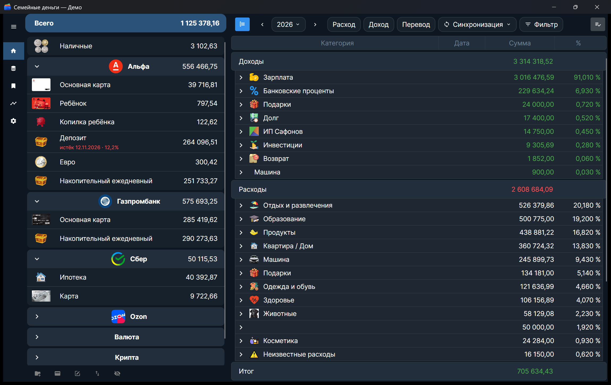
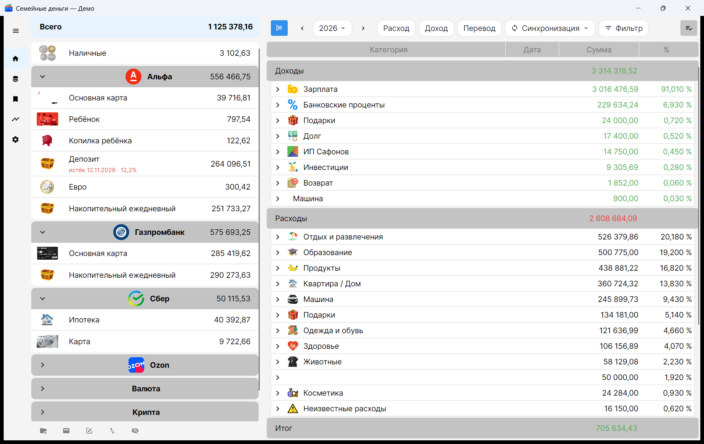
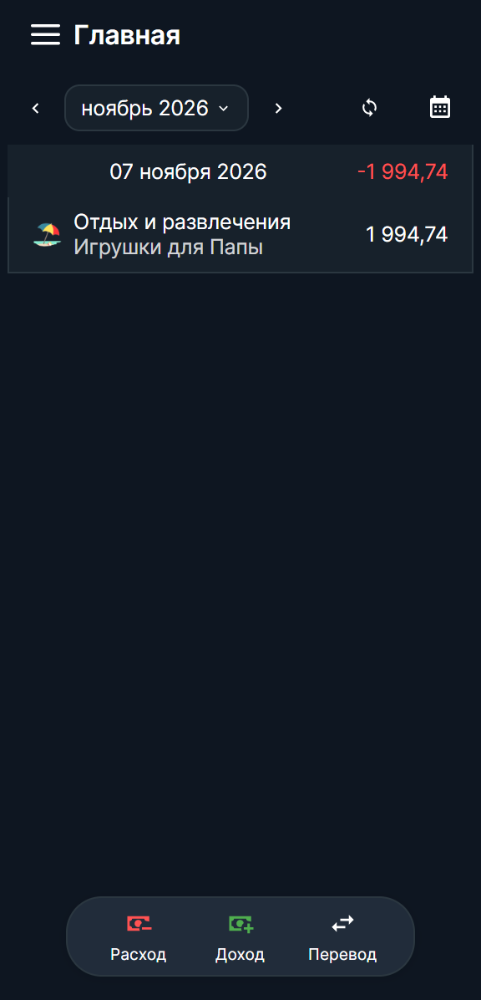
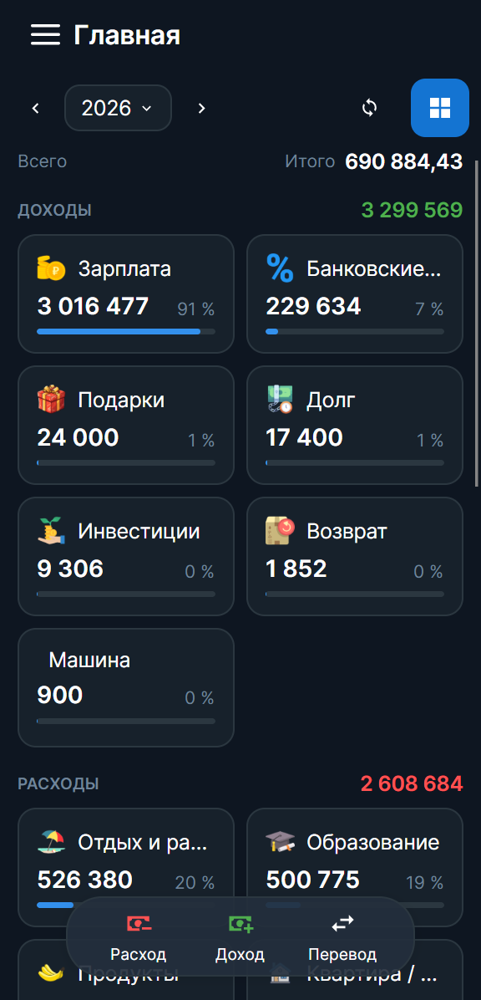
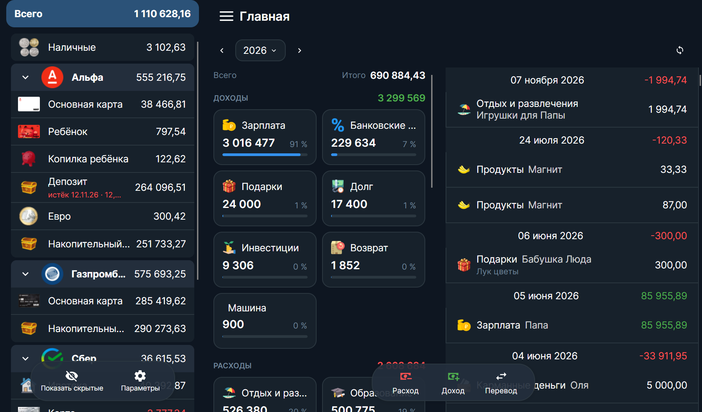

# Семейные деньги

Кроссплатформенное приложение для учёта семейных финансов: счета, транзакции, категории, аналитика по периодам и синхронизация между устройствами.

## О программе

Проект создан как собственная реализация домашнего финансового учёта — с теми возможностями и мелочами, которых не хватало в готовых программах. 

Данные хранятся локально в LiteDB.

## Возможности

- **Счета** — иерархия (группы и вложенные счета), иконки, скрытие счетов, перетаскивание для изменения порядка
- **Транзакции** — расход, доход, перевод; комментарии и теги; список по датам или дерево по категориям
- **Категории** — отдельные списки для доходов, расходов и переводов; подкатегории
- **Периоды** — день, месяц, квартал, год, произвольный интервал, «всё время»
- **Отчёты** — два режима: «Таймлайн» (остаток на счёте и потоки денег по годам, месяцам и дням) и «Топ расходов» (карточки самых больших трат с долей от общих расходов)
- **Несколько баз данных** — переключение между семейными/личными базами
- **Синхронизация** — через S3-совместимое хранилище, WebDAV или папку на диске; журналы по устройствам и опциональное E2E-шифрование; кнопка «Синхронизация» на главном экране
- **Мобильная версия** — Android и компактный desktop-интерфейс навигации с боковым меню и плавающей панелью действий
- **Резервное копирование** — автоматические бэкапы базы по настройке

## Скриншоты

### Desktop — тёмная тема



Слева — счета и навигация, справа — дерево категорий и транзакций за выбранный период.

### Desktop — светлая тема



### Мобильный интерфейс

Android и компактный desktop используют один и тот же интерфейс навигации.

| Телефон — дни | Телефон — сводка по категориям |
|---|---|
|  |  |

Планшет, альбомная ориентация — сводка и дни рядом:



Скриншоты сделаны на демонстрационной базе.

## Горячие клавиши (Desktop)

Классический интерфейс `FamilyMoney.Desktop`. Сочетания работают на главном экране, если фокус не в поле ввода (в текстовых полях действуют стандартные **Ctrl+X** / **Ctrl+C** / **Ctrl+V**).

### Транзакции

| Клавиши | Действие |
|---------|----------|
| **Alt+C** | Новый расход |
| **Alt+D** | Новый доход |
| **Alt+T** | Новый перевод |
| **Esc** | Снять выделение с транзакций |

### Период

| Клавиши | Действие |
|---------|----------|
| **Ctrl+←** | Предыдущий период |
| **Ctrl+→** | Следующий период |
| **Ctrl+P** | Меню выбора периода |
| **Ctrl+1** | День |
| **Ctrl+2** | Месяц |
| **Ctrl+3** | Квартал |
| **Ctrl+4** | Год |
| **Ctrl+5** | Произвольный интервал |

### Счета

| Клавиши | Действие |
|---------|----------|
| **Ctrl+↑** | Предыдущий счёт в списке |
| **Ctrl+↓** | Следующий счёт в списке |

### Окно транзакции

| Клавиши | Действие |
|---------|----------|
| **Ctrl+Alt+←** | Предыдущий день |
| **Ctrl+Alt+→** | Следующий день |
| **Enter** | Добавить тег (в поле ввода тега) |
| **Enter** | Сохранить (**OK**) — если фокус не в поле суммы или сумма не менялась |
| **Esc** | Отмена |

#### Поле «Сумма»

Поле поддерживает ввод с клавиатуры и выпадающий калькулятор (кнопка справа). Кнопка калькулятора **не попадает в цепочку Tab** — **Tab** переходит сразу к следующему элементу формы.

| Клавиши | Действие |
|---------|----------|
| **F4** | Открыть калькулятор |
| **Enter** | Посчитать выражение или принять новое значение (например, `100+50`, `30*1.2`; операции слева направо) |
| **Enter** | Сохранить (**OK**) — если выражения нет и сумма не изменилась |

Те же возможности доступны для поля «Сумма зачисления» при переводе между счетами.

#### Калькулятор (когда открыт)

| Клавиши | Действие |
|---------|----------|
| **0–9** | Цифры (основная клавиатура и NumPad) |
| **,** / **.** / **б** | Дробная часть |
| **+** **−** **×** **÷** | Операции (+ на **Shift+=**, × на **Shift+8**, ÷ на **/**) |
| **=** | Вычислить |
| **Enter** | Вычислить; повторное нажатие — применить сумму и закрыть |
| **Backspace** | Удалить последний символ |
| **C** / **Delete** | Очистить |
| **Esc** / **F4** | Закрыть без применения |

В остальных диалогах (счёт, категория, база данных, выбор периода) **Enter** подтверждает, **Esc** — отменяет.

## Отчёты

Раздел «Отчёты» — два режима с независимыми фильтрами.

### Таймлайн

Показывает выбранный период как временную шкалу:

- верхняя полоса — остаток на счёте на конец каждой отсечки (столбцы и линия тренда);
- нижняя полоса — поступления вверх и списания вниз, в своей шкале;
- шаг отсечек подстраивается под ширину: годы → месяцы → дни;
- счёт выбирается в шапке: «Всего», группа или отдельный счёт — с иконками, как в списке счетов;
  скрытые счета в списке не показываются, но в суммы по группе и «Всего» входят.

Управление: перетаскивание левой кнопкой (или свайп) — прокрутка; колесо мыши и горизонтальная
прокрутка тачпада — тоже прокрутка, а **Ctrl+колесо**, кнопки с луппой или «щипок» — масштаб;
двойной клик по графику возвращает шкалу к периоду главного экрана.

### Топ расходов

Карточки самых больших трат за период:

- в карточке — категория с иконкой, подкатегория, комментарий, сумма и доля от всех расходов
  периода; при объединении повторов видно, из скольких операций сложилась сумма;
- фильтры: счёт, период (по умолчанию текущий год), размер топа (10 / 20 / 50 / 100) и
  объединение повторов — траты с одинаковыми категорией, подкатегорией и комментарием
  считаются одной;
- переводы тратами не считаются; доля всегда считается от всех расходов периода,
  а не от суммы топа;
- клик по карточке выбирает её и открывает справа панель с её операциями по дням —
  в том же виде, что дневной список; ширину панели можно менять перетаскиванием,
  закрывается крестиком или повторным кликом.

## Платформы

| Проект | Назначение |
|--------|------------|
| `FamilyMoney.Desktop` | Классический интерфейс для Windows и Linux |
| `FamilyMoney.Navigation.Desktop` | Компактный интерфейс с навигацией (Windows, Linux) |
| `FamilyMoney.Android` | Мобильное приложение для Android |

## Технологии

- .NET 10
- [Avalonia UI](https://avaloniaui.net/) 12 + Fluent Theme
- [LiteDB](https://www.litedb.org/)
- [CommunityToolkit.Mvvm](https://github.com/communitytoolkit)
- Синхронизация: S3-совместимое API ([FluentStorage](https://github.com/robinrodricks/FluentStorage)), WebDAV или папка на диске

## Сборка и запуск

Требуется [.NET SDK 10](https://dotnet.microsoft.com/download).

```bash
# Классический desktop (Windows, Linux)
dotnet run --project src/FamilyMoney.Desktop/FamilyMoney.Desktop.csproj

# Навигационный desktop
dotnet run --project src/FamilyMoney.Navigation.Desktop/FamilyMoney.Navigation.Desktop.csproj

# Android APK (нужен Android SDK и JDK 17)
dotnet publish src/FamilyMoney.Android/FamilyMoney.Android.csproj -c Release -f net10.0-android
```

Самодостаточная сборка для Linux и архив для раздачи:

```bash
dotnet publish src/FamilyMoney.Desktop/FamilyMoney.Desktop.csproj -c Release -r linux-x64 \
  -o publish/linux-x64 -p:SelfContained=true -p:PublishSelfContained=true
bash packaging/linux/package.sh publish/linux-x64 FamilyMoney.Desktop-linux-x64.tar.gz
```

Настройки и база данных по умолчанию сохраняются в `%LOCALAPPDATA%\FamilyMoney\` на Windows и в `~/.local/share/FamilyMoney/` на Linux; на Linux сам файл настроек лежит отдельно — `~/.config/FamilyMoney/appsettings.json` (по XDG).

### Linux

В релизах публикуется `FamilyMoney.Desktop-linux-x64.tar.gz` — самодостаточная сборка, .NET runtime внутри. В архиве есть установщик без root:

```bash
mkdir -p familymoney
tar -xzf FamilyMoney.Desktop-linux-x64.tar.gz -C familymoney
cd familymoney
./install.sh            # в ~/.local/opt/familymoney + ярлык в меню приложений
```

Затем приложение запускается из меню как «Семейные деньги» или напрямую:
`~/.local/opt/familymoney/FamilyMoney.Desktop`.

Параметры установщика: `--dir DIR` — другой каталог, `--uninstall` — удалить приложение, ярлык и иконки (данные остаются).

Можно и без установки — запустить бинарник из распакованного архива:

```bash
chmod +x FamilyMoney.Desktop
./FamilyMoney.Desktop
```

База, резервные копии и логи лежат в `~/.local/share/FamilyMoney/` (`logs/` внутри). Нужны системные `libicu`, `fontconfig` и `freetype` — на обычных десктопных дистрибутивах они уже установлены. Приложение работает через X11 или XWayland; на Wayland-сессиях возможен мыльный текст при дробном масштабировании.

### Android

В релизах публикуется `FamilyMoney.Android.apk` — подписанный APK для установки вручную:

1. Скачайте файл из релиза и откройте его на телефоне.
2. Разрешите установку из этого источника (Android спросит один раз).

Требования: Android 6.0+ (minSdk 23), архитектуры `arm64-v8a` и `x86_64` — на 32-битных устройствах приложение не запустится.

Обновления ставятся поверх предыдущей версии: `versionCode` считается от даты сборки, данные сохраняются. Автообновления у APK нет — новую версию нужно скачать из релиза. Подпись делается тем же ключом, что и локальные сборки; при смене ключа приложение придётся переустанавливать с потерей локальных данных.

Для локальной сборки подписанного APK скопируйте `FamilyMoney.Android.Signing.props.example` в `FamilyMoney.Android.Signing.props`, впишите пароли и положите `fm.keystore` рядом с проектом (оба файла в `.gitignore`).

## Лицензия

См. репозиторий автора.
