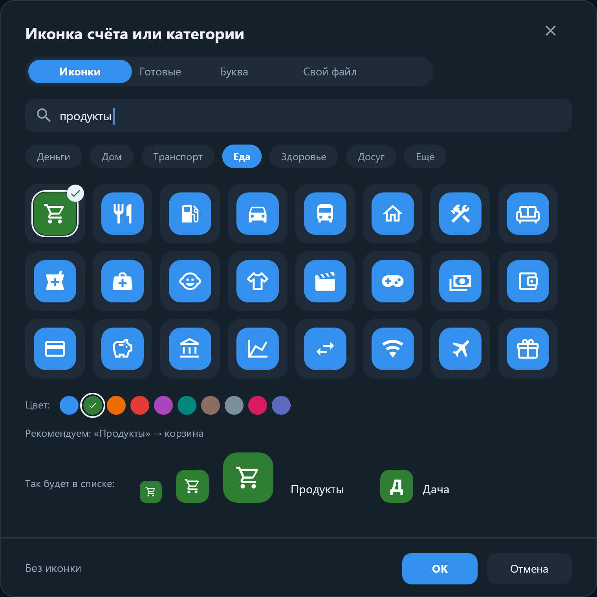
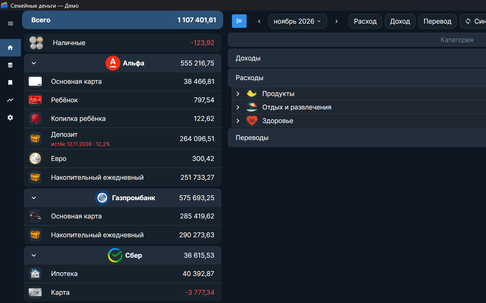
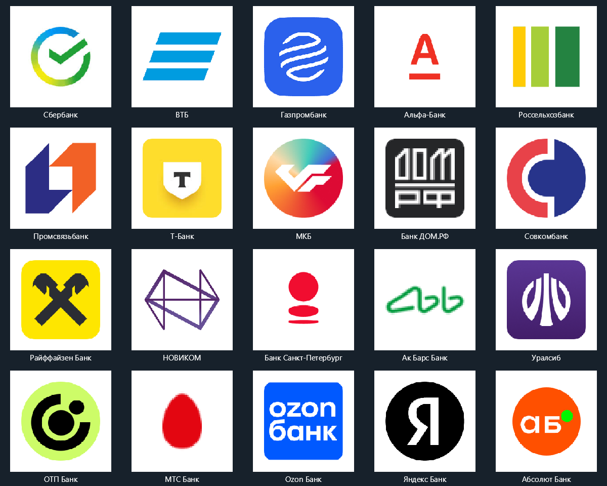
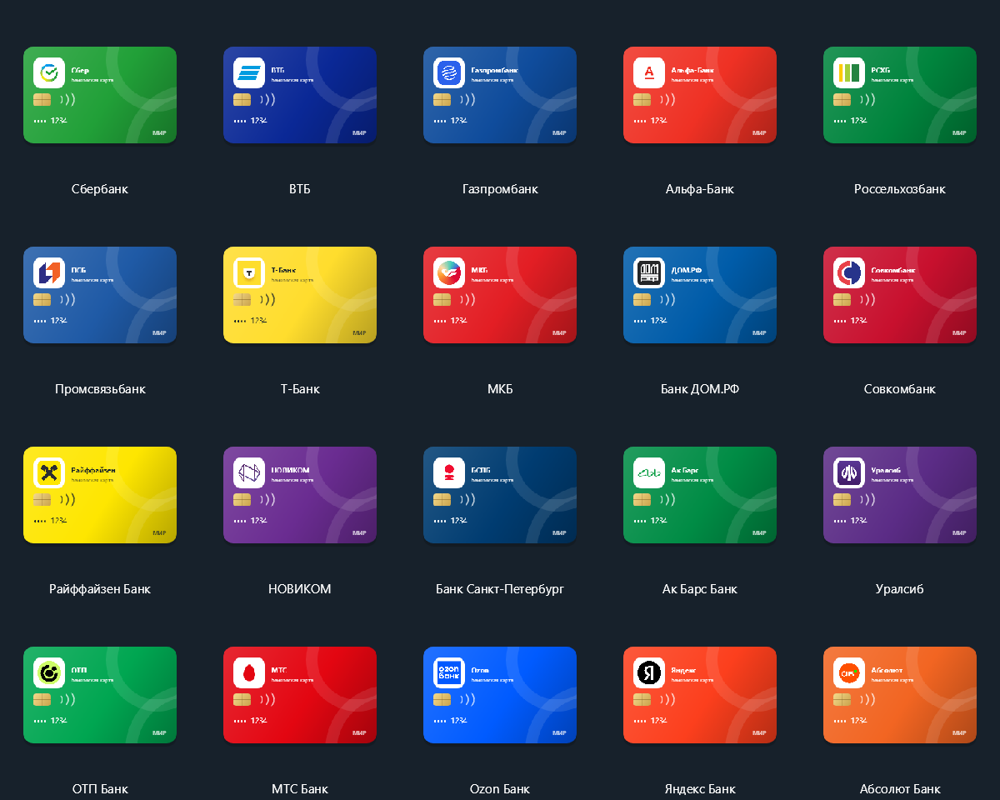
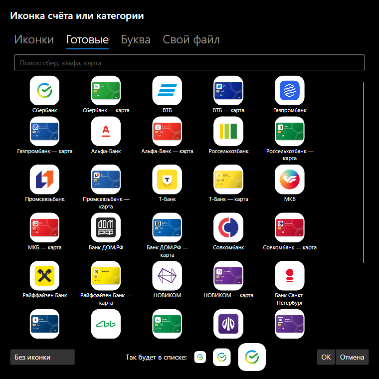
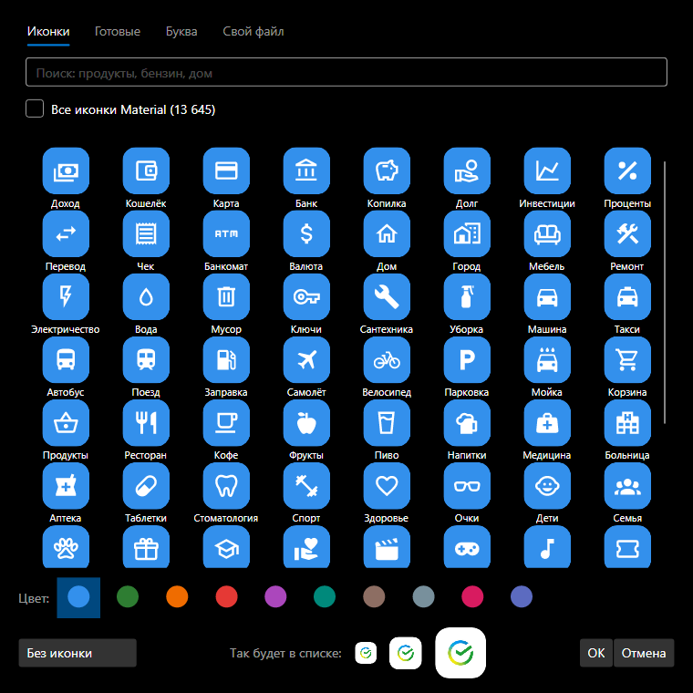
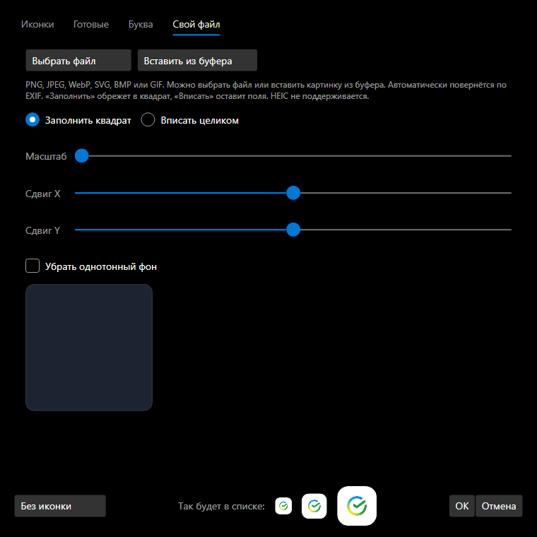
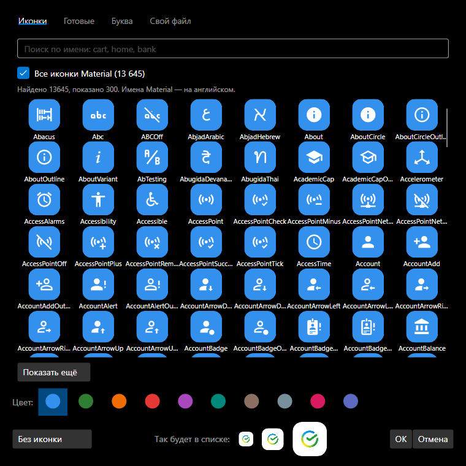

# Иконки и картинки счетов и категорий: дизайн

Статус: этапы 1–5 реализованы: иконки, пикер, нормализация файлов, наборы,
удаление однотонного фона, pan/zoom и массовая подстановка по названиям.
Проверено: 235 unit-тестов, Desktop и signed Android release собираются.
Дата: 21.11.2026.

> **Суть.** Не просить пользователя быть дизайнером: дать каталог готовых
> иконок с подсказкой по названию, цветные бейджи, буквы и наборы готовых
> картинок (банки, карты, иллюстрации). Для своих файлов — автоматическая
> подготовка: поворот, квадрат, 256×256, SVG, перекодирование. Прозрачный фон
> перестаёт быть обязательным, потому что картинка показывается в плитке.

## 1. Проблема

Сейчас картинку можно только загрузить файлом: кнопка «Загрузить картинку из файла»
в `AccountWindow.axaml` и `CategoryWindow.axaml`, плюс drag-and-drop в code-behind.
Мобильной версии редакторов счетов и категорий пока нет.

Пользователь вынужден выполнить работу дизайнера:

1. придумать, что должно быть на картинке;
2. нарисовать или найти её;
3. скачать;
4. убрать фон;
5. обрезать и уменьшить;
6. только потом загрузить.

Технически сейчас не делается даже шаг 5: `ImageConverter.ToImageData` просто
копирует байты потока в `byte[]`, а `LiteDbRepository.UpdateImage` кладёт их в
`FileStorage` как есть. Фотография с телефона на 8–15 МБ попадает в базу и
уезжает в синхронизацию целиком, хотя на экране она показывается размером
20–56 px (декодеры: 48 px в `FamilyMoney.Navigation`, 400 px в
`FamilyMoney.Desktop`).

Дополнительно текущий сценарий неполон:

- иконку нельзя убрать;
- в `IRepository` нет `RemoveImage`, хотя outbox-удаление картинки в
  `LiteDbRepository` уже есть;
- при очистке картинки `AccountsViewModel.Save` падает на
  `new MemoryStream(other.ImageData!)`;
- `CategoriesViewModel.Save` при `ImageData == null` молча оставляет старую
  картинку.

Вывод: проблема не в файловом диалоге. Мы просим пользователя сделать
дизайнерскую работу и при этом не страхуем его ни по фону, ни по размеру.

## 2. Принципы

1. **Сначала готовое, потом своё.** В приложении уже есть `Material.Icons`
   (13 645 иконок в 3.0.2; пакет MIT, сами иконки Material Design Icons —
   Apache 2.0). Для типовой категории ничего искать не нужно.
2. **Иконка не обязательна, но приложение должно выглядеть хорошо без неё.**
   Если пользователь ничего не выбрал, показываем подобранную по названию
   иконку. Это только отображение, в базу ничего не пишем.
3. **Не требовать прозрачного фона.** Картинка показывается в плитке, поэтому
   логотип на белом фоне читается как наклейка, а фото — как миниатюра.
   Вырезание фона становится необязательным улучшением, а не обязательным шагом.
4. **Один разумный размер.** Всё, что больше 256×256, всё равно не видно.
   Храним 256×256; оригинал не храним.
5. **Одна сущность — один источник истины.** Либо встроенная иконка (строка),
   либо своя картинка (байты). Не держим оба одновременно.
6. **Цвет — часть выбора, но по умолчанию акцентный.** Цвет не должен быть
   обязательным шагом и не должен ломать контраст в одной из тем.

## 3. Решение кратко

Вместо кнопки «Загрузить картинку из файла» — диалог **«Иконка»** с четырьмя
источниками:

| Источник | Действий пользователя | Что храним | Размер | Цвет |
|---|---|---|---|---|
| Иконки | 1 клик (поиск/подсказка) | `Icon = "material:CartOutline"` | ~0 | да |
| Готовые картинки | 1 клик | `Icon = "pack:banks/sber"` | 0 в базе, ассет в приложении | нет |
| Буква | 1–2 символа + цвет | `Icon = "letter:П"` | ~0 | да |
| Свой файл / буфер | выбрать, вставить, перетащить | `ImageData` 256×256 | 10–96 КБ | нет |
| Без иконки | 1 клик | `null` + удаление картинки | 0 | — |

Плюс:

- **подсказка по названию** — «Продукты» → корзина, «Бензин» → колонка,
  «Наличные» → кошелёк, «Сбербанк» → готовая картинка из набора;
- **нормализация файла** — ориентация по EXIF, квадрат, 256×256, SVG,
  перекодирование, удаление метаданных;
- **цветные бейджи** — иконка и буква рисуются белым на цветном фоне; цвет
  по умолчанию акцентный, можно выбрать из палитры;
- **наборы готовых картинок** — поставляются с приложением, обновляются от
  версии к версии, принимаются через merge request.

## 4. UX

### 4.1 Точки входа

В `AccountWindow` и `CategoryWindow` вместо одной кнопки:

- превью иконки в плитке;
- основная кнопка **«Выбрать иконку»**;
- вторичная **«Убрать»** (видна, если что-то выбрано);
- клик по превью открывает тот же диалог;
- drag-and-drop файла на превью сохраняется;
- `Ctrl+V` вставляет картинку из буфера, если платформа её отдаёт.

Кнопка называется «Выбрать иконку», а не «Загрузить картинку»: загрузка файла —
лишь один из вариантов, и не основной.

### 4.2 Диалог «Иконка»

```
┌──────────────────────────────────────────────────────────────┐
│  Иконка счёта или категории                              ✕   │
│  [ Иконки ] [ Готовые ] [ Буква ] [ Свой файл ]             │
│  🔍 Поиск: продукты                                         │
│  [Деньги] [Дом] [Транспорт] [Еда] [Здоровье] [Досуг] [Ещё]  │
│  ┌────┬────┬────┬────┬────┬────┬────┬────┐                 │
│  │ 🛒 │ 🍽 │ 🚗 │ ⛽ │ 🏠 │ 💊 │ 🎬 │ 🎁 │  ...            │
│  └────┴────┴────┴────┴────┴────┴────┴────┘                 │
│  Цвет:  ●  ●  ●  ●  ●  ●  ●  ●  ●  ●                        │
│  Рекомендуем: «Продукты» → корзина                          │
│  Так будет в списке:  24 px    36 px    56 px               │
│  [Без иконки]                              [OK]  [Отмена]   │
└──────────────────────────────────────────────────────────────┘
```

Размер окна — около 760×760. Мобильный пикер в текущий объём не входит
(см. 9); когда появится, это будет полноэкранная страница с теми же вкладками.

Схема (не скриншот, данные вымышлены; у категорий внутри «Готовых» другие
группы, а не банки):



Поведение:

- при открытии выбран текущий вариант; если иконки нет — **ничего не выбрано**,
  но рекомендация показана отдельной плиткой с пометкой «Рекомендуем»;
- `OK` без выбора оставляет `null`, fallback всё равно нарисует
  рекомендацию;
- кнопки внизу: `OK` слева от «Отмена», как во всех диалогах приложения
  (правило зафиксировано в `AGENTS.md`);
- двойной клик по плитке = выбрать и закрыть;
- поиск фильтрует по русским названиям, ключевым словам и английским именам
  иконок; пустой результат показывает подсказку «попробуйте: еда, транспорт,
  дом»;
- предпросмотр показывает реальные размеры 24/36/56 px на фоне текущей темы
  и на контрастной половине;
- «Готовые» показывается, если есть хотя бы один набор; для счетов первая
  группа — «Банки», для категорий — иллюстрации и другие наборы;
- цвет показывается для «Иконки» и «Буква», для файлов и готовых картинок
  скрыт.

### 4.3 Сценарии

**«Продукты», ничего не выбрано.** В списке уже нарисована корзина как
fallback. Открыли диалог — корзина отмечена «Рекомендуем», но не выбрана.
Один клик, `OK`. В базе только строка `material:CartOutline` и, если цвет
не меняли, `IconColor = null` (акцент).

**«Сбербанк».** Открываем «Готовые» → группу «Банки», в поиске уже
подставлено название, рекомендация — `pack:banks/sber`. Один клик.

**«Дача».** Вкладка «Буква»: уже подставлена «Д», выбран зелёный. Для
«Дача и огород» подставится «ДО» — по первой букве каждого слова, максимум
две. При желании вводим «ДЧ» или меняем цвет. В базе `letter:Д` + `#2E7D32`.

**Свой логотип.** Вкладка «Свой файл» → выбрать PNG/JPG/SVG → превью →
`OK`. Фон не трогаем: логотип ляжет в плитку.

**Фото с телефона.** Выбрали — приложение само повернёт по EXIF, обрежет
в квадрат, уменьшит до 256 и перекодирует. В диалоге видно: «256×256, 24 КБ»
и «было 12 МБ».

**Убрать иконку.** «Без иконки» → `Icon = null`, `IconColor = null`,
`ImageData = null`, картинка удаляется из `FileStorage` и из синхронизации.

**Ошибка.** HEIC, битый файл, 80 МБ: понятное сообщение, диалог не закрывается,
старая иконка не меняется.

### 4.4 Подсказка по названию

`IconSuggester` — обычный словарь основ слов, без сети и ML. Проверяем
нормализованное название (нижний регистр, `ё → е`), ищем самое длинное
совпадение. Подсказка возвращает не `MaterialIconKind`, а строку-spec:
`material:CartOutline` или `pack:banks/sber`.

| Ключевые слова | Иконка |
|---|---|
| продукт, еда, магазин, супермаркет | `material:CartOutline` |
| кафе, ресторан, обед, кофе | `material:SilverwareForkKnife` / `material:CoffeeOutline` |
| бензин, заправка, топливо | `material:GasStation` |
| машина, авто, такси | `material:Car` / `material:Taxi` |
| транспорт, автобус, метро | `material:Bus` / `material:Train` |
| дом, квартира, аренда, жкх | `material:HomeOutline` / `material:HomeCityOutline` |
| ремонт, инструменты | `material:HammerWrench` |
| мебель | `material:SofaOutline` |
| аптека, лекарства | `material:LocalPharmacy` / `material:Pill` |
| врач, здоровье, больница | `material:MedicalBag` / `material:HospitalBuilding` |
| дети, садик | `material:BabyFaceOutline` |
| одежда, обувь | `material:TshirtCrewOutline` / `material:ShoeSneaker` |
| развлечения, кино, игры | `material:MovieOpen` / `material:GamepadVariant` |
| зарплата, доход | `material:CashMultiple` |
| наличные | `material:WalletOutline` |
| карта, банк (общее) | `material:CreditCardOutline` / `material:BankOutline` |
| вклад, сбережения | `material:PiggyBankOutline` |
| кредит, ипотека, долг | `material:BankOutline` / `material:HandCoinOutline` |
| инвестиции, проценты | `material:ChartLine` / `material:Percent` |
| переводы | `material:SwapHorizontal` |
| связь, интернет | `material:Wifi` / `material:Cellphone` |
| подписки | `material:Autorenew` |
| путешествия, отпуск | `material:Airplane` |
| подарки | `material:GiftOutline` |
| животные, питомцы | `material:PawOutline` |
| налоги, документы | `material:FileDocumentOutline` |
| штрафы | `material:Gavel` |
| образование | `material:SchoolOutline` |
| страхование | `material:ShieldCheckOutline` |
| красота, уход | `material:FaceWomanShimmer` |
| спорт | `material:Dumbbell` |
| коммунальные, свет, вода | `material:FlashOutline` / `material:WaterOutline` |
| сбер, сбербанк | `pack:banks/sber` |
| тинькофф, т-банк, tbank | `pack:banks/tbank` |
| альфа, альфа-банк | `pack:banks/alfa` |
| втб | `pack:banks/vtb` |
| газпромбанк | `pack:banks/gazprombank` |
| райффайзен | `pack:banks/raiffeisen` |
| совкомбанк | `pack:banks/sovcombank` |
| росбанк | `pack:banks/rosbank` |
| почта банк | `pack:banks/pochtabank` |

Полный список — 30–40 групп плюс банковские алиасы; этого хватает на типовую
семейную базу. Если совпадения нет — `material:TagOutline` для категории,
`material:WalletOutline` для счёта, `material:FolderOutline` для группы.

Подсказка не сохраняется в базу и не синхронизируется. Она пересчитывается
при изменении названия.

#### 4.4.1 Почему рекомендация не сохраняется сама

Вопрос был такой: когда пользователь создаёт «Продукты» и не открывает пикер,
приложение должно записать `material:CartOutline` в базу или только нарисовать
корзину?

Решение: **только нарисовать**. Запись в базу — только явный выбор в диалоге.
Причины:

- нет скрытых записей: пользователь не выбирал — в данных пусто;
- переименование категории сразу обновляет подсказку, а не оставляет старую
  иконку;
- не растёт синхронизация и не появляется разница между устройствами из-за
  версии словаря;
- «иконка не обязательна» остаётся честным: база не заполняется тем, что
  пользователь не подтверждал.

Минус: при обновлении словаря подсказок внешний вид fallback может измениться.
Это косметика, данные не страдают; пользователь может один раз выбрать иконку,
и она зафиксируется.

В диалоге рекомендация показывается, но **не выбирается автоматически**:
плитка с пометкой «Рекомендуем», клик — выбор. Так `OK` без действий
оставляет `null`, а не создаёт скрытую запись.

### 4.5 Каталог и поиск

Каталог состоит из трёх слоёв:

1. **Иконки** — 150–200 курируемых иконок с русскими названиями, синонимами и
   группами (Деньги, Дом, Транспорт, Еда, Здоровье, Семья, Досуг, Работа,
   Техника, Разное). Это то, что видно по умолчанию во вкладке «Иконки».
2. **Готовые** — поставляемые с приложением картинки: группы «Банки», «Карты»,
   «Иллюстрации» и т.п. Для счетов группа «Банки» идёт первой. Поиск по
   названию и алиасам («сбер», «тинькофф», «альфа»).
3. **Полный** — все 13 645 имён `MaterialIconKind`. Ищем по английскому имени
   (`Cart`, `GasStation`), результат ограничиваем 120 плитками, показываем
   отдельной секцией «Все иконки (англ.)».

Русский поиск работает по курируемым иконкам и готовым картинкам; для
остального честно пишем, что поиск по английским названиям. Это дешевле и
понятнее, чем переводить 13 тысяч имён.

### 4.6 Вкладка «Буква»

- поле на 1–2 символа, предзаполнено по названию: первая буква каждого слова,
  но не более двух — «Дача» → «Д», «Продукты питания» → «ПП»,
  «Сбербанк России» → «СР»;
- палитра цветов;
- живой предпросмотр в 24/36/56 px;
- подсказка «можно оставить одну букву или ввести две»;
- пустое поле не сохраняется: fallback на подсказку/дефолт.

Буква — не «заглушка», а полноценный бейдж: белый жирный символ на цветном
фоне, тот же размер и скругление, что у иконок. Никакой растровой генерации:
текст рисует Avalonia шрифтом приложения, поэтому он чёткий на любом DPI и
не зависит от системных эмодзи-шрифтов.

### 4.7 Вкладка «Свой файл»

- кнопка выбора файла и кнопка **«Вставить из буфера»** (bitmap или файл
  картинки; работает и `Ctrl+V`, если фокус не в текстовом поле);
- drag-and-drop в окне счёта/категории;
- превью в плитке;
- строка «было → стало»: размеры и вес;
- переключатель «Заполнить / Вписать» (квадрат или поля);
- галочка «Убрать фон» (этап 5), доступна, когда фон распознан как однотонный;
- предупреждение, если файл слишком большой, битый или не поддерживается;
- поддержка SVG (см. 7.2); HEIC — сообщение «пересохраните в JPEG».

### 4.8 Цвет

- `IconColor` — строка `#RRGGBB` или `null`; `null` означает акцентный цвет
  приложения (`AccentBrush`, #3390EC).
- Палитра из 10 цветов; отдельного произвольного color picker в первой версии
  нет — палитра гарантирует контраст.
- Цвет — **фон бейджа**, глиф и буква — белые. Это даёт одинаково читаемый
  результат в светлой и тёмной теме; цветной глиф на серой плитке не проходит
  по контрасту для половины палитры.
- Палитра (все проверены на контраст ≥ 3:1 с белым и с фоном карточек):

| Цвет | Hex | Белый глиф / светлая карточка | Тёмная карточка |
|---|---|---|---|
| Акцент | `#3390EC` | 3,31 | 4,92 |
| Зелёный | `#2E7D32` | 5,13 | 3,18 |
| Оранжевый | `#EF6C00` | 3,08 | 5,29 |
| Красный | `#E53935` | 4,23 | 3,85 |
| Фиолетовый | `#AB47BC` | 4,82 | 3,38 |
| Бирюзовый | `#00897B` | 4,32 | 3,77 |
| Коричневый | `#8D6E63` | 4,62 | 3,52 |
| Серый | `#78909C` | 3,35 | 4,86 |
| Розовый | `#D81B60` | 4,95 | 3,29 |
| Индиго | `#5C6BC0` | 4,86 | 3,35 |

- Цвет применяется к «Иконки» и «Буква». Для своих картинок и готовых
  картинок он скрыт: там цвет уже есть в изображении.
- В сетке каталога плитки показаны в акцентном цвете; палитра меняет цвет
  выбранной плитки и превью, а не всего каталога.
- Если пользователь меняет иконку, цвет сохраняется; если выбирает «Без
  иконки» — очищается.
- Старые записи без `IconColor` показывают акцент.

### 4.9 Клавиатура и доступность

- `Enter` — `OK`, `Esc` — «Отмена»;
- стрелки — перемещение по сетке, `Tab` — по вкладкам;
- у каждой плитки `ToolTip` с названием;
- выбранная плитка отличается не только цветом: рамка + галочка;
- название категории остаётся рядом с иконкой — иконка не единственный носитель
  смысла;
- цвет не кодирует смысл: категории различаются подписью и формой, а не только
  оттенком.

## 5. Данные и синхронизация

### 5.1 Формат иконки

Одно поле `Icon` — строка-spec:

| Значение | Смысл |
|---|---|
| `material:CartOutline` | иконка Material |
| `letter:П` | буква (1–2 символа) |
| `pack:banks/sber` | ассет из набора |
| `null` | нет иконки; работает fallback |

Правила:

- префикс обязателен для новых записей; старые значения без префикса
  (`CartOutline`) тоже читаем;
- `material:` — имя `MaterialIconKind`, регистр терпимый, `Enum.IsDefined`
  обязателен, иначе `Enum.TryParse` принимает `"123"`;
- `letter:` — 1–2 буквы/цифры, верхний регистр, без пробелов и двоеточий;
- `pack:` — `<packId>/<assetId>`, только `[a-z0-9-]`;
- неизвестный/устаревший spec не ломает чтение: fallback.

`IconColor` — `#RRGGBB` или `null`; необязательное поле.

### 5.2 Модели и синхронизация

В `Models.Account` и `Models.Category`:

```csharp
/// <summary>material:CartOutline, letter:П или pack:banks/sber. null — картинка или fallback.</summary>
public string? Icon { get; set; }

/// <summary>#RRGGBB; null — акцентный цвет.</summary>
public string? IconColor { get; set; }
```

- `Account` сериализуется через `AccountSyncModel` — добавить оба поля туда и в
  `ToAccountSyncModel`/`FromAccountSyncModel`.
- `Category` сериализуется как есть, поля поедут автоматически.
- Схему БД менять не нужно: nullable-поля, старые документы читаются с `null`.
- Старые клиенты:
  - иконку не покажут (увидят fallback) — не страшно;
  - при редактировании сущности старый клиент может потерять `Icon` и
    `IconColor`, потому что пишет JSON целиком. Это редкое событие, но релизить
    десктоп и Android лучше вместе. Восстановление — одно нажатие.
- Картинки (файлы) синхронизируются как раньше, отдельным каналом.
- Ассеты наборов не синхронизируются: синхронизируется только строка
  `pack:...`; на другом устройстве она разрешается из его версии приложения.

### 5.3 Приоритет отображения

1. `ImageData != null` → картинка (вписывается целиком, без обрезки);
2. `Icon` начинается с `pack:` → ассет набора;
3. `Icon` начинается с `letter:` → буква;
4. `Icon` начинается с `material:` → иконка;
5. `Icon == null` или spec не разобрался, **и `ShowFallback` включён** →
   подсказка по названию;
6. подсказки нет (или fallback выключен) → пусто/дефолт типа.

При сохранении выбирается ровно один источник: выбрали иконку/букву/готовую
картинку — чистим `ImageData` (с удалением файла); выбрали файл — чистим `Icon`
и `IconColor`. Для готовой картинки и файла `IconColor` не используется и
сохраняется `null`, чтобы не было скрытого состояния.

### 5.4 Отображение: `IconBadge`

Вместо пары `Image` + `MaterialIcon` в каждом месте — один контрол
`IconBadge` в `FamilyMoney.Navigation/Controls`:

Свойства:

- `ImageData` (`byte[]?`);
- `Icon` (`string?`);
- `IconColor` (`string?`);
- `EntityName` (`string?`) — для подсказки;
- `Fallback` (`MaterialIconKind`) — дефолт типа;
- `ShowFallback` (`bool`) — для счетов в списках `false`: без картинки/явной
  иконки ничего не рисуем; для категорий и превью пикера `true`;
- `CollapseWhenEmpty` (`bool`) — схлопнуть контрол, если картинки/иконки нет,
  чтобы не оставлять пустое место (у групп без картинки);
- `Size` (`double`) — 24/32/36/56;
- при необходимости `CornerRadius` / `Padding`.

Контрол сам разбирает spec, выбирает источник, рисует:

- **иконка/буква** — цветной бейдж со скруглением, белый глиф/буква;
- **картинка** — нейтральная плитка `GroupBackBrush`, изображение
  вписывается целиком с полями и обрезается по скруглению только геометрическим
  `Clip` внутри контрола, а не по содержимому;
- **ассет набора** — фон из манифеста (обычно белый), логотип с полями;
- **fallback** — акцентный бейдж с дефолтной иконкой.

Это убирает дублирование и гарантирует одинаковый вид во всех списках,
диалогах, выпадающих списках и на мобильном. `DisplayIcon` в ViewModel не
нужен: контрол получает сырые `Icon`/`IconColor`/`ImageData` и `EntityName`.

Для `TimelineScope` (запись выпадающего списка отчётов) добавить `Icon` и
`IconColor`, чтобы `IconBadge` работал и там.

### 5.5 Удаление картинки

Добавить в `IRepository`:

```csharp
void RemoveImage(Guid id); // FileStorage.Delete + EnqueueImageDelete
```

Вызывать из `AccountsViewModel.Save` и `CategoriesViewModel.Save`, когда
`ImageData` был, а стал `null`. Реализовать в `LiteDbRepository`,
`DesignerRepository` и тестовых двойниках. Заодно починить:

- `AccountsViewModel.Save`: не делать `new MemoryStream(other.ImageData!)` при
  `null`;
- `CategoriesViewModel.Save`: различать «не меняли» и «очистили».

Это нужно и для вкладки «Без иконки», и просто для аккуратности.

### 5.6 Старые данные

Никакой массовой миграции нет: `UpdateDbSchema` не сканирует картинки, фоновых
задач нет. Старые большие картинки остаются как есть, пока пользователь сам не
откроет и не пересохранит сущность (см. 7.5). Это осознанное решение: не трогаем
данные без действия пользователя.

## 6. Отображение

### 6.1 Где менять

`IconBadge` вместо текущих пар `Image` + `MaterialIcon`:

- `AccountWindow.axaml`, `CategoryWindow.axaml` — превью;
- `CategoriesView.axaml` — строка категории и выбранная категория;
- `AccountsView.axaml` — строки счетов, группы, drag-превью;
- `AccountsDrawerView.axaml` — мобильный список;
- `TransactionEditPage.axaml` — счёт, категория, счёт получателя;
- `SelectionPage.axaml` — выбор счёта/категории и строка операции;
- `TransactionsSummaryView.axaml` — карточка категории;
- `TimelineScope` / `TimelineScopeCatalog` — выпадающий список отчётов.

### 6.2 Геометрия бейджа

- категория в списке — 36×36, скругление 10, глиф 20;
- выбранная категория — 56×56, глиф 30;
- счёт в списке — 32×32, глиф 18 (сейчас картинка 40×30 без подложки);
- строки выбора в операции — 24×24, глиф 14;
- буква: 1 символ — ~52% высоты, 2 символа — ~38%, белая, жирная;
- картинка **вписывается целиком** (`Uniform`), не обрезается: у широких
  изображений остаются поля нейтрального фона. Для иконок/букв — бейдж.

Сейчас `CategoryIcon` уже похож на плитку (`GroupBackBrush`, `CornerRadius`), но
картинка внутри 24×24 и без обрезки. Для счетов подложки нет вовсе.

### 6.3 Цвет и тема

- цветной бейдж одинаков в светлой и тёмной теме; белый глиф на цвете;
- фон страницы/карточки меняется, но палитра подобрана так, чтобы бейдж не
  терялся;
- картинки и готовые картинки не перекрашиваются;
- если картинка с прозрачностью — виден нейтральный фон плитки, это нормально;
- если без — она выглядит как наклейка, и это нормально; вырезать фон не нужно.

### 6.4 Fallback

- категория — `TagOutline`;
- счёт — без fallback в списках: если нет ни картинки, ни явной иконки,
  место остаётся пустым (подсказка по названию не рисуется);
- группа счетов — тоже без fallback;
- подсказка по названию показывается только в пикере как рекомендация,
  а не в списке счётов.

Список счетов на демо-базе после этих правок:



## 7. Обработка своего файла

### 7.1 Пайплайн

`ImageNormalizer` (core, SkiaSharp):

В `FamilyMoney.csproj` добавляется `SkiaSharp` 3.119.4 — та же версия, что уже
в `FamilyMoney.Navigation.Desktop`. Для Android нужно проверить, что
`libSkiaSharp` попадает в APK (обычно приходит с Avalonia.Android; если нет —
`SkiaSharp.NativeAssets.Android`).

1. **Проверки до декодирования.** Размер файла ≤ 20 МБ, стороны ≤ 12 000,
   площадь ≤ 40 Мп. Иначе — сообщение, без загрузки в память.
2. **Определяем формат.** SVG → `Svg.Skia` (шаг 3); остальное → `SKCodec`/
   `SKBitmap` (шаг 4).
3. **SVG.** Рендерим через `Svg.Skia` в 256×256 (см. 7.2).
4. **Декодирование растра.** `SKCodec`/`SKBitmap`; учитываем EXIF-ориентацию
   (`EncodedOrigin`): поворот/отражение.
5. **Фон** (этап 5, по галочке). См. 7.4.
6. **Кадрирование.** «Заполнить»: центральный квадрат; «Вписать»: картинка
   целиком на прозрачном/белом фоне. Zoom и сдвиг — в пикере.
7. **Ресайз** до 256×256 с высоким качеством.
8. **Кодирование.** Есть альфа → PNG; нет → JPEG q85. Если больше 96 КБ —
   q75, затем 192 px, затем 128 px.
9. **Метаданные.** Всё лишнее (EXIF, GPS, ICC) отбрасываем: меньше вес и не
   уезжают геометки.
10. **Фон** — по галочке, см. 7.4.

Скругление углов в пиксели не запекаем: его делает `IconBadge` при
отображении. Иначе для непрозрачной картинки пришлось бы всегда переходить
на PNG с альфой и терять вес.

Возвращаем байты, фактические размеры, вес, флаг «есть альфа» и
предупреждение. Работаем в `Task.Run`, UI не блокируем.

### 7.2 SVG

- Поддержка SVG — да, в этапе 3.
- Пакет `Svg.Skia` (уже используется в `resources/SvgPng.csx`), рендер в
  256×256 с прозрачным фоном, цвета сохраняем.
- Ограничения: файл ≤ 2 МБ, без внешних ссылок (`http`, `file`), без
  встроенных data-изображений больше лимита; скрипты не исполняются
  рендерером, но вход всё равно считаем недоверенным.
- Если у SVG нет размеров — берём `viewBox`; если и его нет — ошибка.
- Анимацию не поддерживаем: первый кадр/статичный рендер.
- Результат проходит тот же путь, что PNG: 256×256, альфа, лимит веса.

### 7.3 HEIC и остальное

- JPEG, PNG, WebP, BMP, GIF (первый кадр), SVG — поддерживаем.
- HEIC/HEIF — не декодируется Skia; показываем «HEIC не поддерживается,
  пересохраните в JPEG». Без платформенных костылей.
- AVIF пока не обещаем; сообщение аналогичное.
- Битый файл — сообщение, старая иконка сохраняется.

### 7.4 Удаление фона

Галочка в пикере, по умолчанию **выключена**. Без ML и без сети — только для
однотонного фона, которого достаточно у скачанных логотипов:

1. сэмплируем рамку 1–2 px по периметру;
2. если доминирующий цвет покрывает ≥ 60% рамки — считаем фон однотонным;
3. flood fill от краёв с допуском по цвету (24/255 на канал);
4. на границе — мягкая альфа, чтобы не было зубцов;
5. если вырезалось < 5% или > 90% площади — отменяем и говорим «фон не
   распознан», чтобы не съесть сам логотип.

Галочка по умолчанию **выключена**. Это необязательная косметика; плитка и
скругление решают задачу внешнего вида. Если фон не распознан, картинка
остаётся как была и показывается предупреждение.

### 7.5 Старые картинки: только ручное пересохранение

Массовой миграции нет. Если пользователь открывает редактор счёта/категории и
там уже есть картинка больше 256×256 или тяжелее 96 КБ:

- показываем пометку «Картинка будет сжата до 256×256 при сохранении»;
- при «OK» нормализуем в режиме **«Вписать»**: сохраняем пропорции, вписываем
  в квадрат с полями, без обрезки, без удаления фона и без смены типа
  изображения;
- при «Отмене» ничего не меняем;
- если картинка уже в пределах — не трогаем.

Это и есть «пользователь сам пройдётся и пересохранит»: без фоновых проходов
по базе и без неожиданных изменений. Новые загрузки нормализуются сразу.

## 8. Готовые картинки (наборы)

### 8.1 Что это и что такое «бандл»

«Бандл» — это файлы внутри установочного пакета приложения (APK/zip). Они
доступны сразу, без сети и без отдельного экрана загрузки. Альтернатива —
скачиваемый набор при первом обращении: меньше установочный пакет, но нужны
сеть, место и версионирование. Для 1–2 МБ картинок выбираем бандл; если набор
вырастет, его можно вынести в опциональную загрузку, не меняя ссылки `pack:`.

Поставляемый с приложением набор изображений, на которые ссылается `Icon`:
`pack:banks/sber`. В базе и синхронизации — только строка, сами картинки
лежат в приложении. Это позволяет:

- не хранить и не синхронизировать картинки;
- обновлять набор от версии к версии;
- принимать новые картинки через merge request;
- использовать одну и ту же картинку на всех устройствах без загрузки файла.

Наборы — не только банки: «Банки», «Бизнес», «Продукты», «Транспорт» и т.п.
Каждый набор — отдельный каталог с манифестом; в пикере он показывается
отдельной группой. Логотипы банков — один из наборов, а не единственный смысл
раздела.

### 8.2 Структура

```
src/FamilyMoney.Navigation/Assets/Packs/
  banks/
    pack.json
    sber.png
    tbank.png
    alfa.png
    ...
  business/
    pack.json
    ...
  products/
    pack.json
    ...
```

Новая группа — это новый каталог с `pack.json` и заголовком `title`
(«Бизнес», «Продукты», «Транспорт»); его id добавляется в `KnownPacks` в
`PackCatalog`. Существующие `pack:`-ссылки не меняются.

`pack.json`:

```json
{
  "id": "banks",
  "title": "Банки",
  "version": 3,
  "notice": "NOTICE-banks.md",
  "assets": [
    {
      "id": "sber",
      "name": "Сбербанк",
      "aliases": ["сбер", "sber", "сбербанк"],
      "file": "sber.png",
      "background": "#FFFFFF",
      "kind": "logo",
      "source": "https://...",
      "addedIn": "1.5.0",
      "deprecated": false
    }
  ]
}
```

- `id` — стабильный, латиница/цифры/дефис, никогда не переиспользуется;
- `aliases` — для поиска и подсказки;
- `background` — цвет плитки под картинкой (обычно белый; логотипы
  проектировались под белый фон);
- `source` — желательно указать для происхождения, но он не блокирует MR;
- `addedIn` — версия приложения, чтобы понимать совместимость;
- `deprecated` — картинка ещё лежит, но новый выбор не предлагаем.

Файлы — PNG 192–256 px, альфа или объявленный фон, ≤ 32 КБ. 100 картинок —
около 1,5–2 МБ в APK; это приемлемо, но бюджет надо держать.

### 8.3 Загрузка и fallback

- `PackCatalog` читает манифесты через `AssetLoader` из
  `avares://FamilyMoney.Navigation/Assets/Packs/...`;
- `IconBadge` разрешает `pack:` в bitmap, кэширует по пути;
- если пакет/ассет не найден (старая версия приложения, битый манифест,
  удалённый логотип) — показываем `material:BankOutline` для счёта или
  `material:TagOutline` для категории, без падения и без пустого места;
- манифест битый — логируем и отключаем пакет, остальное приложение работает.

### 8.4 Пикер и подсказки

- вкладка «Готовые» видна для счетов и категорий;
- внутри — группы по `title` каждого набора: сейчас «Банки» (40 картинок),
  дальше «Бизнес», «Продукты», «Транспорт» и т.д.;
- у группы виден заголовок и количество картинок; поиск фильтрует и группы,
  и картинки;
- сетка картинок, поиск по `name`/`aliases`;
- `IconSuggester` для счетов: если название содержит банковский алиас —
  рекомендует `pack:banks/...`;
- если ассет отсутствует, рекомендация откатывается на `material:BankOutline`.

### 8.5 Версии и merge request

- набор аддитивный: новые картинки добавляются, существующие `id` не меняются;
- переименование банка/картинки — новый `name`/`aliases`, `id` прежний;
- удаление — `deprecated: true` на 1–2 релиза, затем удаление файла; ссылки
  падают в fallback;
- замена картинки — тот же `id`, новый файл, `version++`;
- MR-шаблон: имя/алиасы, файл, `addedIn`, источник (если известен); отдельного
  подтверждения прав не требуем — это решение проекта;
- CI/скрипт проверяет: уникальные `id`, существующие файлы, размер/сторону,
  альфу/фон, все `pack:` из подсказок разрешаются; `source` не обязателен.

### 8.6 Источник и удаление

Обязательного подтверждения прав нет — это осознанное решение проекта.
Приложение открытое, а набор может содержать не только чужие товарные знаки,
но и иллюстрации, иконки карт и другие материалы. Поэтому мы не блокируем
добавление юридической проверкой, но фиксируем происхождение и реагируем на
запросы.

Правила:

- в манифесте — `source` (если известен), `addedIn`, автор MR;
- `NOTICE`/README набора — с происхождением и просьбой сообщать о проблемах;
- по запросу правообладателя или автора картинка удаляется либо помечается
  `deprecated`, ссылки откатываются в fallback;
- спорные случаи решает мейнтейнер; история MR сохраняется.

Это не юридическая гарантия, а политика проекта: набор отделён от
пользовательских картинок, поэтому его можно убрать/заменить, не ломая данные.

### 8.7 Первый набор (v1)

Собран в `src/FamilyMoney.Navigation/Assets/Packs/banks/`:

- 20 банков: Сбербанк, ВТБ, Газпромбанк, Альфа-Банк, Россельхозбанк,
  Промсвязьбанк, Т-Банк, МКБ, Банк ДОМ.РФ, Совкомбанк, Райффайзен Банк,
  НОВИКОМ, Банк Санкт-Петербург, Ак Барс Банк, Уралсиб, ОТП Банк, МТС Банк,
  Ozon Банк, Яндекс Банк, Абсолют Банк;
- у каждого две картинки: квадратная иконка (`<id>.png`) и стилизованная
  карта (`<id>-card.png`);
- всего 40 PNG 256×256, около 0,5 МБ; `pack.json` и `NOTICE-banks.md` рядом;
- исходники и генератор — `resources/banks/src` и
  `resources/render_bank_pack.csx`;
- проверка — `dotnet script resources/validate_bank_pack.csx`.

Критерий отбора: крупнейшие и заметные розничные банки. Инфраструктурные
НКО/НРД, BM-Банк, а также уходящие Ситибанк и ЮниКредит в первый набор не
включены — для типового семейного счёта они не нужны. Если нужен строгий
топ-20 по активам, состав можно заменить, не меняя формат.

Карты — не официальные изображения продуктов, а стилизованные макеты по
бренд-цветам и иконкам; это указано в `NOTICE-banks.md`.





### 8.8 Категорийные наборы

Добавлены 9 групп по 12–14 картинок (всего 120 PNG) из
[OpenMoji](https://openmoji.org/) (CC BY-SA 4.0):

| `id` | Группа | Картинок |
|---|---|---:|
| `business-finance` | Бизнес и финансы | 12 |
| `products` | Продукты | 14 |
| `home` | Дом и квартира | 14 |
| `transport` | Машина и транспорт | 14 |
| `leisure` | Отдых | 13 |
| `animals` | Животные | 14 |
| `education` | Образование | 12 |
| `fashion` | Одежда и косметика | 14 |
| `health` | Здоровье | 13 |

- PNG 256×256, прозрачный фон, ≤ 32 КБ; на белой плитке `IconBadge`;
- `pack.json` и `NOTICE-openmoji.md` в каждом каталоге, авторы указаны
  построчно; корневой обзор — `Assets/Packs/README-openmoji.md`;
- OpenMoji зафиксирован на коммите `3e01de5`, повторная сборка —
  `resources/fetch_openmoji_packs.py` (Python + cairosvg + Pillow);
- лицензия CC BY-SA 4.0: при распространении набора сохраняются атрибуция и
  share-alike; это отдельно от пользовательских картинок.



## 9. Android

Мобильный пикер в текущий объём не входит. Что важно не сломать:

- отображение иконок на Android уже работает через `MaterialIcon`; `IconBadge`
  живёт в `FamilyMoney.Navigation`, поэтому его можно использовать и там;
- `Icon`/`IconColor` синхронизируются как обычные поля, картинки — как раньше;
- если на Android встретится `pack:`, ассет есть в той же сборке Navigation,
  поэтому логотип отрисуется; если версия старая — fallback;
- редакторов счетов и категорий на Android пока нет, поэтому и пикера нет.

Когда мобильные редакторы появятся, `IconBadge` и парсер уже будут готовы;
отдельного дизайна не требуется.

## 10. Этапы

| Этап | Что входит | Зачем | Оценка |
|---|---|---|---|
| **1. Фундамент** | `Icon`/`IconColor` в моделях/VM, парсер spec, `IconBadge`, подсказки, `RemoveImage`, фиксы очистки, замена разметки, плитки | Приложение выглядит осмысленно без действий пользователя; готова точка для пикера | M |
| **2. Пикер** | Диалог: «Иконки», «Готовые», «Буква», «Свой файл», поиск, палитра, рекомендация, «Без иконки», подключение к окнам | Основной сценарий: 1 клик вместо поиска картинки | M |
| **3. Файл** | `ImageNormalizer`: EXIF, квадрат, 256, SVG, лимиты, превью «было/стало», ленивое сжатие старых при пересохранении | Решает разрешение и вес; убирает шаги «обрезать/уменьшить» | M |
| **4. Наборы** | `pack:`, `PackCatalog`, вкладка «Готовые», группы, манифест, CI-валидация, источник/удаление, MR-процесс | Готовые картинки без файлов и синхронизации; ассеты v1 уже собраны | M–L |
| **5. Комфорт** | Авто-удаление фона, pan/zoom, массовая подстановка по названиям | Для тех, кому мало каталога | M |

Порядок 1→2→3→4 даёт законченный полезный результат. Этапы 1–4 уже в рабочем
дереве; удаление фона и pan/zoom остаются на этап 5.

### 10.1 Что уже в коде

- `Models.Account`/`Category` — поля `Icon`, `IconColor`; синхронизация счёта
  и категории.
- `Utils/IconSpec`, `IconColor`, `IconPalette`, `IconSuggester`, `IconLetter`,
  `IconCatalog`.
- `Navigation/Controls/IconBadge` — картинка, `pack:`, буква, Material-иконка,
  цветной бейдж и fallback.
- `Navigation/Services/PackCatalog` — чтение `pack.json`, ассетов и групп
  по `title` набора; 10 групп, 160 картинок.
- `Assets/Packs/README-openmoji.md` — атрибуция OpenMoji и состав групп.
- `Navigation/ViewModels/IconPickerViewModel` и
  `Desktop/Views/IconPickerWindow` — вкладки, поиск, палитра, превью.
- `Utils/ImageNormalizer` — EXIF-ориентация, квадрат 256×256, PNG/JPEG,
  качество/ресайз под 96 КБ, SVG через `Svg.Skia`, HEIC-сообщение, лимиты,
  удаление однотонного фона и кадрирование zoom/offset.
- Пикер нормализует файл при выборе, показывает «было/стало», режимы
  «Заполнить»/«Вписать», слайдеры масштаба/сдвига, drag по превью и галочку
  удаления фона. Слайдеры дебаунсятся (180 мс), предыдущая фоновая
  нормализация отменяется — иначе очередь задач забивается при перетаскивании.
- «Свой файл» принимает картинку из буфера (`Ctrl+C` в другом приложении →
  «Вставить из буфера» или `Ctrl+V`) либо файл из списка файлов буфера; дальше
  тот же `ImageNormalizer`.
- Вкладка «Иконки»: курируемый набор плюс чекбокс «Все иконки Material
  (13 645)» — поиск по английскому имени, 300 на страницу, «Показать ещё».
- В настройках — «Иконки по названиям»: подставляет иконки пустым счетам и
  категориям без картинок, не трогая уже заданные.
- Старые картинки > 256 px или > 96 КБ дожимаются при сохранении редактора
  (режим «Вписать»), с пометкой в окне.
- `IRepository.RemoveImage`, очистка картинки в сохранении счёта/категории.
- `resources/validate_bank_pack.csx` — проверка набора.

Ещё нет: отдельного произвольного цвета — по решению оставлены только
10 предопределённых цветов.

Так выглядит реализованный диалог (тестовая VM, не реальные данные):








## 11. Тесты и приёмка

Unit:

- `IconSpec.TryParse`: `material:`, `letter:`, `pack:`, старый формат без
  префикса, мусор, `"123"`, больше двух букв, неверный `pack:`;
- `IconColor.TryParse`: `#RRGGBB`, регистр, невалидный, `null`;
- палитра: контраст ≥ 3:1 с белым и с фоном карточек (можно тестом);
- `IconSuggester`: «Продукты», регистр, «ё», пустое имя, банковские алиасы,
  самое длинное совпадение;
- `AccountSyncModel`: round-trip `Icon`/`IconColor`; категория с полями;
  старая запись без полей;
- `RemoveImage`: файл удалён, outbox содержит tombstone;
- `ImageNormalizer`: SVG → 256×256 PNG с альфой, HEIC отклонён, лимит 20 МБ,
  битый файл, внешние ссылки SVG, JPEG/PNG-перекодирование, `NeedsNormalization`,
  удаление однотонного фона, отказ на пёстром фоне, zoom/offset, ленивое
  сжатие старой картинки;
- ленивое сжатие: старая картинка > 256 сжимается при сохранении, пропорции
  сохранены, при отмене не меняется;
- `AccountsViewModel.Save`/`CategoriesViewModel.Save`: установка, замена,
  очистка картинки без падения;
- `PackCatalog`: манифест, отсутствующий ассет → fallback, дубликаты id,
  необязательный `source`.

Ручная матрица:

- светлая/тёмная тема, масштаб 100/150/200%, Desktop;
- «Продукты» → рекомендация; поиск «бензин»; пустой поиск; полный каталог;
- цвет: каждая из 10 красок на обеих темах, белый глиф читается;
- буква: «Д», «ДЧ», «Продукты питания» → «ПП», «Дача и огород» → «ДО»,
  кириллица/латиница, пустое поле;
- «Сбербанк» → «Готовые» → «Банки», картинка, отсутствующий ассет;
- фото 12 МП → 256×256, вес ≤ 96 КБ, превью совпадает со списком;
- PNG с прозрачностью; логотип на белом; SVG; HEIC; битый файл; 80 МБ;
- «Убрать» → иконка исчезла, синхронизировалась на второе устройство;
- старая база открывается без миграции; старая картинка сжимается только при
  пересохранении; старый клиент не падает.

Приёмка:

- новую категорию можно снабдить иконкой за один клик, не выходя из приложения;
- ни одна новая картинка не превышает 256×256 и 96 КБ;
- иконки и буквы читаются в обеих темах;
- банковский логотип выбирается без файла и синхронизируется как строка;
- «Без иконки» работает и синхронизируется;
- всё работает офлайн.

## 12. Риски и альтернативы

**Почему цветные бейджи, а не цветной глиф.** Глиф на существующей серой плитке
не проходит контраст для половины палитры; бейдж с белым глифом даёт
предсказуемый результат в обеих темах и тот же вид для буквы.

**Почему буква — текст, а не PNG.** Растр требует генерации, веса и фиксирует
цвет; текст рисует Avalonia шрифтом приложения, чётко на любом DPI, и
перекрашивается вместе с бейджем.

**Почему не raster-иконки в `ImageData`.** Так было бы меньше изменений:
отрисовали Material-иконку в PNG и сохранили как картинку. Но тогда:
иконка не перекрашивается под тему, занимает килобайты вместо нуля, дублируется
в синхронизации, а каталог требует рендера. Строка `Icon` дешевле и лучше.
Raster остаётся для своих файлов.

**Почему не web-поиск картинок и не генерация.** Офлайн-приложение, нет ключей
и оплаты, лицензии на скачанное, приватность, непредсказуемый результат.
Каталог, наборы и свои файлы покрывают сценарий.

**Почему не ML-сегментация фона.** Тянет модель, вес, разрешения, время
запуска; для 24–56 px выигрыш сомнительный. Однотонный фон — дешёвый и
предсказуемый частный случай; это этап 5, не обязательный.

**Смешанные версии.** Старый клиент может потерять `Icon`/`IconColor` при
редактировании. Риск низкий, последствие косметическое; релизить вместе.

**Имена иконок.** При обновлении `Material.Icons` имя может исчезнуть —
`TryParse` вернёт `false`, покажется fallback. Версию пакета фиксируем.

**Наборы и удаление.** Обязательного подтверждения прав нет — это решение
проекта; набор открытый, и по запросу картинка удаляется/помечается
`deprecated`. Механизм `pack:` позволяет заменить/убрать ассеты, не ломая
ссылки. Юридическую проверку можно добавить позже, не меняя формат данных.

**Размер APK.** Банки — 40 PNG, около 0,5 МБ; категорийные наборы — ещё
120 PNG, около 1 МБ. Бюджет контролируем при добавлении; при росте — 128 px
или отдельная поставка.

**Поиск по 13k английских имён.** Не идеален для русскоязычного пользователя,
поэтому курируемый слой и готовые картинки — основной, полный — бонус.

## 13. Открытые вопросы

1. Нужен ли строгий топ-20 по активам (с Банком РОССИЯ/BM-Банком) или
   достаточно текущего розничного набора?
2. Массовую подстановку сейчас запускает кнопка в настройках; нужен ли
   предварительный список «что изменится»?
