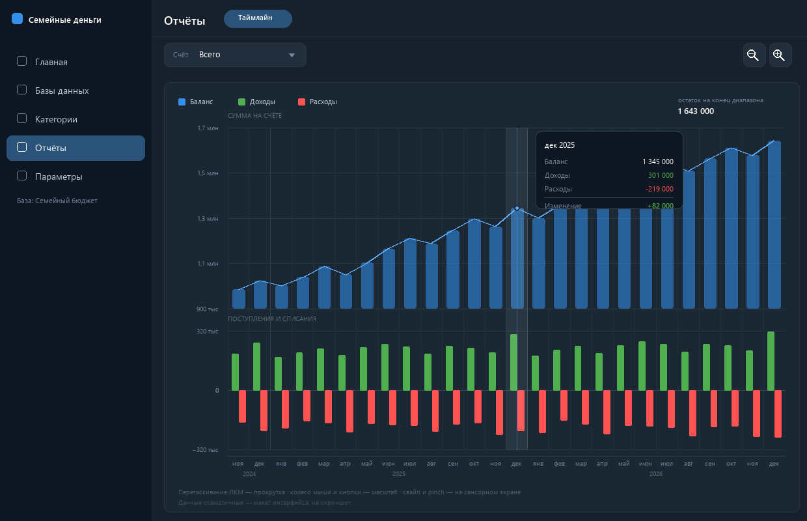
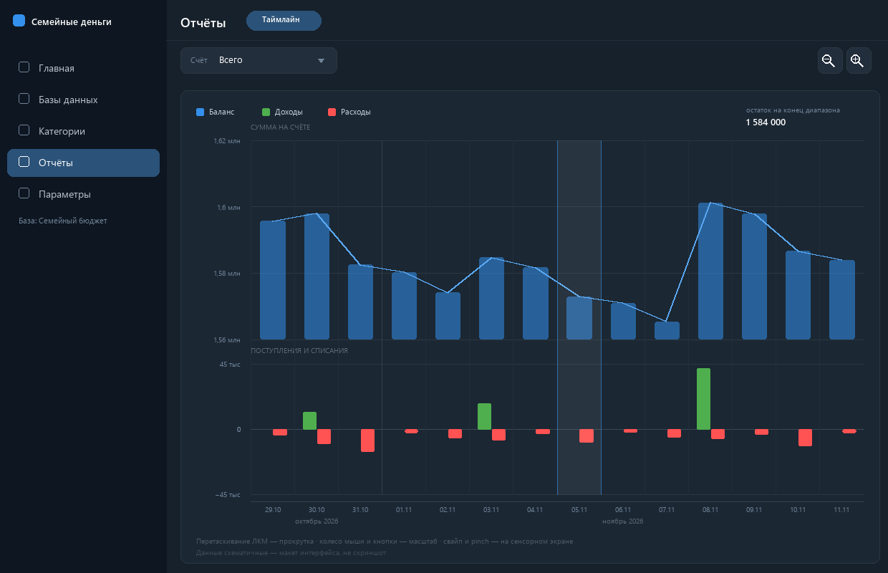
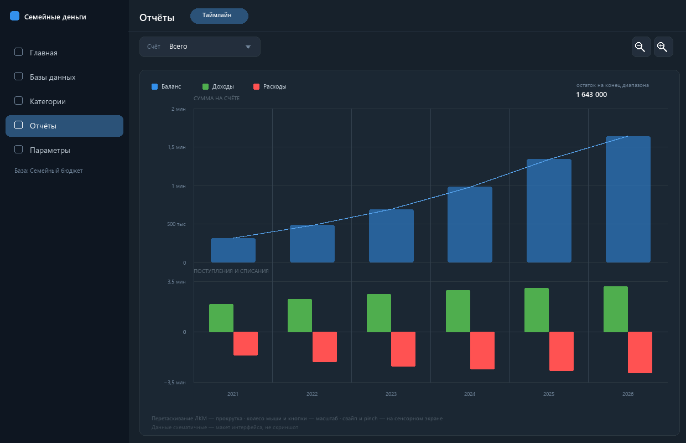

# Отчёты → Таймлайн: план реализации

Новый раздел десктопного приложения (`FamilyMoney.Desktop`) для выбранной базы: экран «Отчёты»
с единственным режимом отображения «Таймлайн» — интерактивная временная шкала баланса,
доходов и расходов.

Макеты интерфейса (схема, не скриншот — данные выдуманы):







---

## 1. Что делаем (скоуп P1)

1. В боковом меню появляется раздел **«Отчёты»** (рядом с «Главная», «Категории», «Параметры»).
2. Внутри — переключатель режимов отображения с единственным пунктом **«Таймлайн»**
   (задел на будущие отчёты: «По категориям», «Динамика» и т.п.).
3. Каждый вход в раздел открывает шкалу на периоде, выбранном на главном экране.
4. Прокрутка: зажатая ЛКМ + перетаскивание, свайп на сенсорном экране.
5. Масштаб: колесо мыши (к курсору), pinch, кнопки с луппой `−` / `+`.
6. Шаг отсечек: **годы → месяцы → дни** (мельче дня не идём — в базе у операции только дата,
   без времени).
7. Верхняя полоса — остаток на счёте на конец каждой отсечки (столбцы + линия тренда).
8. Нижняя полоса — поступления вверх, списания вниз, в своём масштабе.
9. Выбор счёта — компактный выпадающий список «Всего» / счёт / группа.
10. Подсказка при наведении: суммы за отсечку, баланс, изменение.

Вне P1: мобильная версия, экспорт, разрезы по категориям, сравнение периодов, прогнозы,
одновременное отображение нескольких счетов.

---

## 2. На что опираемся в существующем коде

| Механизм | Где | Как используем |
|---|---|---|
| Разделы приложения | `src/FamilyMoney/Services/MainPanel.cs`, `MainWindow.axaml` (боковое меню + переключаемые панели) | добавляем `MainPanel.Reports` и панель `ReportsView` |
| Период | `ViewModels/PeriodViewModel.cs` | единственный экземпляр; при открытии раздела и при смене периода читаем `MainState` |
| Общее состояние | `State/MainState.cs` (`SelectedAccountId`, `PeriodFrom/To`, `FlatAccounts`), `StateManager` + `MainStateChangedMessage` | стартовый период и счёт, сигнал о смене периода/базы |
| События | `Messages/SimpleMessages.cs` (`MainStateChangedMessage`, `DatabaseChangedMessage`, `TransactionChangedMessage`) | пересчёт и сброс шкалы |
| Данные | `DataAccess/IRepository.GetTransactions`, `DataAccess/AccountBalanceCalculator` | загрузка операций, правила знака |
| Оформление | `FamilyMoney.Navigation/Themes/AppThemeResources.axaml` (`AccentBrush`, `PositiveBrush`, `NegativeBrush`, `LikeGridLinesBrush`, `TextSecondaryBrush`) | цвета графика, темы Light/Dark |
| Иконки | `Material.Icons.Avalonia` (`ChartTimelineVariant`, `MagnifyPlus`, `MagnifyMinus` — проверил, есть в 3.0.2) | пункт меню и кнопки масштаба |
| DI | `AppInit.cs` | регистрация `ReportsViewModel` / `TimelineViewModel` |

Текущее состояние: `dotnet build src/FamilyMoney.Desktop` — успешно, 0 предупреждений.

---

## 3. Экран

### 3.1 Шапка

- Слева — название раздела «Отчёты» и пилюля режима «Таймлайн».
- В строке управления только два элемента:
  - **Счёт**: выпадающий список «Всего» + группы и счета, как на главном экране: иконка счёта,
    вложенные с отступом, группы полужирным. Скрытые счета в списке не показываются
    (скрытая группа скрывает и своё содержимое).
  - **Кнопки масштаба**: две квадратные кнопки с луппой и `+` / `−`.
- Индикатора периода, плашки «масштаб: …» и кнопки «К периоду» нет: масштаб виден по шкале X,
  даты — по подписям оси, а период задаётся на главном экране.

Скрытость счёта — только фильтр списка: при выборе «Всего» или группы скрытые счета
в сумму входят как обычно (см. §4.4).

Период меняется на главном экране (там же, где и раньше). Каждый вход в раздел «Отчёты»
открывает шкалу заново от текущего периода — это заменяет «К периоду» и совпадает с ожиданием
«открыл отчёты — вижу свой период».

### 3.2 Область графика

Одна карточка, внутри — две полосы с общей осью X.

**Верхняя полоса «Сумма на счёте» (~60 % высоты).**
- Столбец на каждую отсечку: высота = баланс на конец периода; ширина ≤ 56 px, чтобы при
  сильном зуме не получались гигантские блоки.
- Поверх столбцов — линия тренда (2 px) акцентным цветом.
- Своя шкала Y, 4–5 «круглых» значений, подписи компактно (`1,64 млн`, `918 тыс`).
- Низ шкалы подписан всегда — столбцы растут от него, а не от нуля, это должно быть видно.

**Нижняя полоса «Поступления и списания» (~40 %).**
- Нулевая линия по центру, вверх — доходы (`PositiveBrush`), вниз — расходы (`NegativeBrush`).
- Своя симметричная шкала (`320 тыс` / `0` / `−320 тыс`), не связана со шкалой баланса.

Почему две полосы, а не один график: остаток на счёте и месячный поток отличаются на порядок —
в общей шкале столбцы доходов/расходов стали бы невидимыми полосками.

**Ось X строится по видимому окну, а не по данным.** Подписи есть всегда, даже если в окне нет
ни одной операции: прокрутил вправо — видишь новые даты. Подписи отсечек + «крупная» строка
(год для месяцев, месяц для дней) с более ярким разделителем.

**Подсказка.** При наведении — подсветка отсечки, точка на линии баланса и карточка: период,
баланс на конец, доходы, расходы, изменение баланса. Если есть переводы, отдельной строкой
«в т.ч. переводы». Не влезает справа — карточка раскрывается влево.

### 3.3 Состояния

- Нет операций в окне: «Нет операций за этот период» (шкала остаётся, даты видны).
- По счёту вообще нет истории: «По счёту ещё нет операций».
- Загрузка дольше 150 мс: полупрозрачный оверлей, старый график остаётся на месте.
- Тёмная/светлая тема — только через `DynamicResource`, без хардкода цветов.

---

## 4. Правила расчёта

### 4.1 Ось времени и корзины (отсечки)

Корзины выровнены по календарю, а не по «первой операции»:

| Масштаб | Границы корзины | Подпись |
|---|---|---|
| Годы | 1 января – 31 декабря | `2026` |
| Месяцы | 1-е – последнее число | `янв`…`дек`, год отдельной строкой |
| Дни | один день | `05.11`, месяц отдельной строкой |

Первая и последняя корзины могут выходить за границы окна — значения считаются по полному
календарному периоду, обрезается только отрисовка. Иначе половина месяца за краем экрана давала
бы заниженную сумму.

### 4.2 Баланс

`Баланс(конец корзины)` = накопленная сумма всех операций по выбранному счёту до конца корзины
включительно, от начала истории. Не «сумма внутри видимого окна» — иначе при прокрутке график
показывал бы бессмысленные числа.

Правила знака — как в `AccountBalanceCalculator`:

| Операция | Влияние на баланс счёта |
|---|---|
| Доход (`DebetTransaction`) | `+Sum` |
| Расход (`CreditTransaction`) | `−Sum` |
| Перевод со счёта | `−Sum` |
| Перевод на счёт | `+ToSum` |

### 4.3 Доходы и расходы: как учитывать переводы

Считаем **чистый вклад каждой операции в баланс выбранной области** и раскладываем его по
столбцам:

```
delta = (ToSum, если счёт-получатель входит в область, иначе 0)
      − (Sum,   если счёт-отправитель входит в область, иначе 0)

delta > 0 → в столбец доходов
delta < 0 → в столбец расходов
delta = 0 → операция не рисуется вовсе
```

Что это даёт на практике:

| Случай | Столбец |
|---|---|
| Перевод ушёл из выбранного счёта | расход на `Sum` |
| Перевод пришёл на выбранный счёт | доход на `ToSum` |
| «Всего»/группа, оба счёта внутри, суммы равны | **ничего** — перевод сам себя нивелировал |
| «Всего»/группа, оба счёта внутри, `ToSum ≠ Sum` (курс, комиссия) | разница в доход или расход |
| Группа, внутри только отправитель | расход на `Sum` |

Отдельной серии переводов нет — они уже внутри столбцов. Следствие: в подсказке показываем
«изменение баланса» (фактическое, с переводами), а не пересчёт «доходы − расходы»; при наличии
переводов добавляется строка «в т.ч. переводы».

### 4.4 Выбор области

| Область | Что суммируем |
|---|---|
| «Всего» | все счета; группы — сумма потомков |
| Группа | все счета-потомки на любую глубину |
| Счёт | только он |

Скрытые (локально скрытые на этом устройстве) счета участвуют в суммах по «Всего» и по группе —
они скрыты только из списка выбора и с главного экрана, но деньги на них никуда не деваются.

`IsNotSummable` соблюдаем как в `AccountViewModel.RecalcByChildren`: счёт с этим флагом не входит
в сумму родителя (но если выбран он сам — считается). Для «Всего» результат должен совпадать
с числом в левой панели главного экрана — простая проверка на глаз.

### 4.5 Стартовое окно

- Окно = период главного экрана (`PeriodFrom..PeriodTo`).
- Минимальная ширина окна — **14 дней**: если выбран день, окно расширяется симметрично вокруг
  него, а дни периода подсвечиваются полосой. Сам период при этом не меняется.
  Причина: при шаге «дни» окно в 1 день — это ровно одна отсечка, то есть один столбец на весь
  экран; прокручивать и сравнивать нечего. В 14-дневном окне выбранный день виден в окружении
  соседних дней (см. макет «дни»).
- `PeriodType.All` даёт `DateTime.MinValue..MaxValue` → подрезаем к фактическим датам данных
  (первая … последняя операция). Пустая база — «последние 12 месяцев».
- Прокрутка ограничена диапазоном «данные ∪ исходный период» плюс один экран запаса с каждой
  стороны: за пустоту не уезжаем и не теряемся.

### 4.6 Мелочи

- `Transaction.Date` хранится без времени (`.Date`), поэтому дни считаются точно.
- Деньги: `decimal`, форматирование как в приложении (`#,##0.00`), на осях — компактное
  (`1,64 млн`, `918 тыс`, `12 500`), culture — текущая.
- Месячные подписи — фиксированно `ru-RU` (`янв`, `фев`, …), чтобы не зависеть от локали ОС.

---

## 5. Взаимодействие

### 5.1 Жесты

| Ввод | Действие |
|---|---|
| ЛКМ + перетаскивание | прокрутка по времени (мышь и перо) |
| Свайп одним пальцем | то же |
| Колесо мыши | зум относительно курсора |
| Pinch двумя пальцами | зум относительно центра жеста |
| `Shift` + колесо | горизонтальная прокрутка (трекпад) |
| Кнопки `−` / `+` | ступенчатый зум вокруг центра |
| Двойной клик по графику | сброс к периоду (страховка, если уехал далеко) |

Зум геометрический, шаг 1,15 на щелчок, с якорем: точка под курсором остаётся на месте.

```
newStart = anchor - (anchor - start) / factor
newEnd   = anchor + (end - anchor) / factor
```

Ограничения: минимальное окно при ручном зуме — 3 дня (стартовое — не меньше 14 дней, §4.5),
максимальное — см. §4.5.

### 5.2 Выбор масштаба

Шаг отсечек зависит от ширины окна, а не только от периода:

```
maxBuckets = max(3, plotWidth / 28)         // цель ~28 px на отсечку

если дней в окне   <= 2 * maxBuckets → Дни
иначе если месяцев <= maxBuckets     → Месяцы
иначе                                → Годы
```

При ширине графика ~860 px: дни — до 60 дней, месяцы — до 30 месяцев, дальше годы.
Гистерезис ±20 % по числу корзин, чтобы график не «мигал» на границе масштабов.
Константы — в одном месте (`TimelineBuckets.ChooseScale`), после первых запусков на реальных
данных подкрутим.

### 5.3 Клавиатура

Только при фокусе на графике (чтобы не конфликтовать с хоткеями главного экрана, где
`Ctrl+←/→` уже заняты сменой периода):

- `←` / `→` — прокрутка на 10 % окна;
- `+` / `−` — зум; `0` — сброс к периоду.

---

## 6. Архитектура

### 6.1 Новые файлы

| Файл | Назначение |
|---|---|
| `src/FamilyMoney/Analytics/TimelineScale.cs` | `enum TimelineScale { Years, Months, Days }` + переходы |
| `src/FamilyMoney/Analytics/DailySeries.cs` | дневные агрегаты + префиксные суммы, `BalanceAt(day)`, `Sum(from,to)` |
| `src/FamilyMoney/Analytics/TimelineSeriesBuilder.cs` | операции + набор счетов → `DailySeries` |
| `src/FamilyMoney/Analytics/TimelineScopeResolver.cs` | «Всего»/группа/счёт → счета-листья с учётом `IsNotSummable` |
| `src/FamilyMoney/Analytics/TimelineBucket.cs` | `record TimelineBucket(Start, End, Balance, Income, Expense, TransfersIn, TransfersOut, Count)` |
| `src/FamilyMoney/Analytics/TimelineBuckets.cs` | `Build(series, from, to, scale)`, `ChooseScale(...)` |
| `src/FamilyMoney/Analytics/NiceTicks.cs` | «круглые» деления оси, «красивый» низ шкалы |
| `src/FamilyMoney/Utils/MoneyFormat.cs` | `Compact(...)`, `Full(...)` |
| `src/FamilyMoney/ViewModels/Reports/ReportsViewModel.cs` | контейнер раздела (пока один режим) |
| `src/FamilyMoney/ViewModels/Reports/TimelineViewModel.cs` | окно, масштаб, данные, команды, подсказка |
| `src/FamilyMoney.Desktop/Controls/TimelineControl.cs` | отрисовка и жесты (code-only `Control`) |
| `src/FamilyMoney.Desktop/Views/ReportsView.axaml(.cs)` | страница раздела |
| `tests/FamilyMoney.Tests/*` | юнит-тесты расчётной части (опционально, см. §8) |
| `docs/reports-timeline.md`, `docs/mockups/*` | этот план и макеты |

Вся математика — в `FamilyMoney` (без зависимости от Avalonia): тестируется и позже
переиспользуется в Navigation/Android.

### 6.2 Изменения в существующих файлах

| Файл | Изменение |
|---|---|
| `src/FamilyMoney/Services/MainPanel.cs` | `+ Reports` |
| `src/FamilyMoney/AppInit.cs` | `+ ReportsViewModel`, `TimelineViewModel` (singleton) |
| `src/FamilyMoney/ViewModels/MainViewModel.cs` | свойство `Reports`, `EnsureLoaded()` при переключении на раздел, сброс при `DatabaseChangedMessage` |
| `src/FamilyMoney.Desktop/Views/MainWindow.axaml` | пункт меню «Отчёты» (иконка `ChartTimelineVariant`) + панель `ReportsView` по аналогии с `CategoriesView` |
| `README.md` | раздел про отчёты + скриншот (после реализации) |

`MainPanel` — простое перечисление, `isEqualToConverter` уже умеет с ним работать; новых
конвертеров не потребуется.

### 6.3 Контракт «контрол ↔ модель представления»

`TimelineControl` — «глупый» рендерер: не хранит бизнес-состояния, не знает про счета.

Свойства (`StyledProperty`, чтобы работали `DynamicResource` и биндинги):

```
IReadOnlyList<TimelineBucket> Buckets
TimelineScale                 Scale
IReadOnlyList<decimal>        BalanceTicks, FlowTicks
decimal                       BalanceFloor, BalanceCeiling, FlowMax
DateTime?                     HighlightFrom, HighlightTo      // период главного экрана
IBrush                        AccentBrush, PositiveBrush, NegativeBrush,
                              GridBrush, SecondaryTextBrush, TextBrush, CardBrush
```

События (нормализованные, без пикселей внутри модели):

```
event EventHandler<PanEventArgs>   PanRequested    // dxPixels, plotWidth
event EventHandler<ZoomEventArgs>  ZoomRequested   // anchorFraction 0..1, factor
event EventHandler                 ResetRequested  // двойной клик
```

Модель представления считает новое окно и пересобирает `Buckets`. Контрол перерисовывается
по изменению `Buckets`/`Scale`, подсказку и подсветку рисует сам по локальной позиции курсора.
Вся арифметика — в модели, весь пиксельный ввод — в контроле; цикла «контрол пишет в модель,
модель пишет в контрол» нет.

### 6.4 Поток данных

```
LiteDB ──GetTransactions──▶ TimelineViewModel.RefreshSeries()
                                   │
             TimelineScopeResolver│ (какие счета)
             TimelineSeriesBuilder│ (дневные суммы + префиксы)
                                   ▼
                              DailySeries  (кэш, живёт до изменения данных)
                                   │
              TimelineBuckets.Build(series, viewFrom, viewTo, scale)
                                   ▼
                          IReadOnlyList<TimelineBucket>
                                   ▼
                          TimelineControl.Render()
```

Пересборка `DailySeries` — только при смене базы, счёта или данных.
Прокрутка и зум — только `Build` по кэшу, без обращения к базе.

### 6.5 Производительность

- Смена окна не ходит в базу: операции грузятся один раз на область, дальше — префиксные суммы.
- `GetTransactions` вызывается с `AccountId = null` (все операции) и фильтрацией по набору счетов
  в памяти: так корректно работают вложенные группы, а `GetTransactions` сейчас матчит только
  один уровень детей.
- Загрузка идёт **на UI-потоке**: LiteDB открывает файл эксклюзивно, и фоновый запрос ломает
  параллельные обращения остальных экранов (проверено — падало с ошибкой открытия файла).
  Данных семейной базы это не тормозит; если понадобится — сначала общий доступ к соединению,
  потом фон.
- Отрисовка: < 300 столбцов, один `StreamGeometry` на линию, `FormattedText` кэшируется
  по (текст, размер), кэш ограничен 512 записями.
- 1 px линии выравниваем на полпикселя (`Math.Round(x) + 0.5`), иначе размываются.
- Потолок: до ~50 тыс. операций полная загрузка укладывается в десятки миллисекунд.
  Если станет тесно — добавим агрегирующий запрос в репозиторий (§9).

### 6.6 Отрисовка (эскиз)

```csharp
public override void Render(DrawingContext ctx)
{
    var plot = PlotRect;                     // Bounds минус отступы под подписи
    using (ctx.PushClip(plot))
    {
        DrawGrid(ctx, plot);                 // горизонтали по тикам + вертикали по корзинам
        DrawHighlight(ctx, plot);            // полоса периода главного экрана
        DrawBalance(ctx, plot);              // столбцы от BalanceFloor + линия тренда
        DrawFlows(ctx, plot);                // от нулевой линии вверх/вниз
    }
    DrawAxisLabels(ctx);                     // подписи Y (слева) и X (снизу)
    DrawHover(ctx);                          // подсветка + карточка подсказки
}
```

Контрол фокусируемый (`Focusable = true`) и обязательно с непрозрачным фоном карточки —
иначе он не получает события указателя.

---

## 7. Этапы

| № | Этап | Результат | Оценка |
|---|---|---|---|
| 1 | Каркас раздела | `MainPanel.Reports`, пункт меню, пустая `ReportsView`, DI, переключение панелей | 0,5 д |
| 2 | Расчётная часть | `DailySeries`, `TimelineSeriesBuilder`, `TimelineScopeResolver`, `TimelineBuckets`, `NiceTicks`, `MoneyFormat` + тесты | 1,5 д |
| 3 | Статическая отрисовка | `TimelineControl`: сетка, столбцы, линия, две полосы, оси, подписи; данные на реальной базе | 1,5 д |
| 4 | Интерактив | прокрутка ЛКМ/свайпом, зум колесом/pinch/кнопками, ограничения, сброс | 1 д |
| 5 | Подсказка и состояния | hover-карточка, пустые состояния, легенда, подсветка периода | 1 д |
| 6 | Полировка | производительность, темы, README, прогон чек-листа | 0,5 д |

Итого ≈ 6 рабочих дней без учёта правок по вкусу.

---

## 8. Проверка

### Юнит-тесты (предлагаю добавить проект `tests/FamilyMoney.Tests`, xUnit)

Расчётная часть — чистая арифметика, ошибки в ней не видны на глаз:

1. Границы корзин: январь/февраль, 29 февраля, декабрь→январь, границы года.
2. Баланс на конец корзины не зависит от начала видимого окна.
3. Переводы по правилу §4.3: из счёта, на счёт, оба внутри области (равные суммы → ноль,
   разные → разница), только отправитель внутри.
4. «Всего» = сумма потомков; `IsNotSummable` исключается из родителя, но считается как свой счёт.
5. Группа с вложенными группами (глубина 2+).
6. Пустая база, одна операция, отрицательный баланс.
7. `ChooseScale` на границах гистерезиса; `NiceTicks` для диапазонов 0..1, −500..1500, 999..1001.

### Ручной чек-лист

- [ ] Вход в раздел открывает период главного экрана (все шесть типов периода).
- [ ] Повторный вход в раздел возвращает вид к периоду.
- [ ] Прокрутка ЛКМ не «залипает», если курсор вышел за пределы графика.
- [ ] Ось X показывает даты при любой прокрутке, в том числе за пределами данных.
- [ ] Зум колесом держит точку под курсором.
- [ ] Переключение масштаба годы→месяцы→дни и обратно без мерцания.
- [ ] Счёт/группа/«Всего»: цифры совпадают с левой панелью.
- [ ] Перевод между двумя счетами не меняет столбцы в «Всего», но виден на каждом счёте.
- [ ] Добавление и удаление операции на главной сразу отражается на графике.
- [ ] Переключение базы: шкала и счёт сбрасываются, данные новые.
- [ ] Тёмная и светлая темы, окно 1280×720 и максимизированное.
- [ ] Пустая база / счёт без операций.
- [ ] 100 % и 150 % DPI.

---

## 9. Риски

| Риск | Смягчение |
|---|---|
| Столбцы баланса «от низа» вводят в заблуждение | низ шкалы всегда подписан; при малом балансе автоматически берётся 0; линия тренда поверх столбцов |
| На дневном масштабе столбцы почти одинаковой высоты (узкий диапазон) | линия тренда несёт мелкую динамику; если на реальных данных читается плохо — на масштабе «дни» переключаемся на заливку+линию |
| Путаница «изменение баланса ≠ доходы − расходы» | переводы раскладываются по чистому вкладу (§4.3), в подсказке — строка «в т.ч. переводы» |
| Мелкие месяцы при широком окне | правило выбора масштаба по ширине + гистерезис |
| Полная загрузка операций на большой базе | кэш дневной серии, фоновый поток, при необходимости — агрегирующий запрос в репозиторий |
| События указателя не приходят в кастомный контрол | всегда рисуем фон карточки + `Focusable`, при необходимости обёртка `Border` с `Background="Transparent"` |
| Двойное срабатывание хоткеев периода | хоткеи на графике не пересекаются с хоткеями главного экрана (`←/→/+/-/0` только при фокусе) |

---

## 10. Открытые вопросы

1. **Минимальное окно 14 дней** для периода «день» — ок или другое число? (см. §4.5 и макет «дни»)
2. **Тесты**: добавляем проект `tests/FamilyMoney.Tests`? В репозитории тестов пока нет.
3. **Сохранение состояния**: запоминать масштаб и счёт между запусками (в `appsettings.json`,
   как `Transactions.MaxTransactionsByDate`)? Предлагаю во второй итерации.

Решено ранее: вид баланса — как на макете; счёт синхронизируется только при открытии (дальше
независимо); переводы учитываются по чистому вкладу; название раздела — «Отчёты»; период,
плашка масштаба и «К периоду» из шапки убраны.

---

## 11. После P1 (задел)

- Клик по отсечке → период главного экрана = эта отсечка, переход на «Главную».
- Вторая серия: накопительный итог по категории.
- Сравнение двух счетов или периода с периодом.
- Экспорт видимого диапазона в CSV/изображение.
- Тот же контрол в `FamilyMoney.Navigation` (компактный desktop и Android) — математика уже
  вынесена в `FamilyMoney`, переносится только вью.

---

## 12. Статус реализации

Готово (P1 целиком):

- раздел «Отчёты» в боковом меню (`MainPanel.Reports`), режим «Таймлайн»;
- выбор счёта («Всего» / группа / счёт), старт — с периодом и счётом главного экрана;
- две полосы: остаток на конец отсечки (столбцы + линия) и потоки (доходы вверх, расходы вниз);
- шаг отсечек годы → месяцы → дни по ширине окна, с гистерезисом;
- прокрутка ЛКМ/свайпом, зум колесом, pinch, кнопками, `Shift`+колесо, двойной клик и `0` — сброс;
- подсказка при наведении с балансом, потоками, переводами и изменением;
- пустые состояния, тёмная и светлая темы;
- 47 юнит-тестов расчётной части (`tests/FamilyMoney.Tests`, xUnit), сборка без предупреждений.

Отличия от первоначального плана:

- **Загрузка синхронная, без `Task.Run`**: LiteDB держит файл эксклюзивно, фоновый запрос валил
  параллельные обращения (см. §6.5).
- **Период в шапке не понадобился** — вместо `PeriodStripView` остались только выбор счёта
  и кнопки масштаба, как и договаривались.
- В общую тему добавлен `TextPrimaryBrush` (для текста подсказки и цифр на тёмной/светлой теме).
- `MainWindow.axaml.cs` не менялся: переход в раздел идёт через существующий `SwitchToCommand`.

Осталось на потом: сохранение выбранного счёта/масштаба между запусками, тесты модели
представления (сейчас покрыта только арифметика), клик по отсечке с переходом на «Главную».

Доработки после первого запуска:

- список счетов в шапке — с иконками и отступами, группы полужирным (как на главном экране);
- скрытые счета убраны из списка, но продолжают участвовать в суммах по «Всего» и группе;
- исправлена подсказка на дневных отсечках: попадание курсора сравнивалось по моменту времени,
  и у отсечки «день» (Start == End) оно почти никогда не срабатывало — теперь сравнение по датам.
