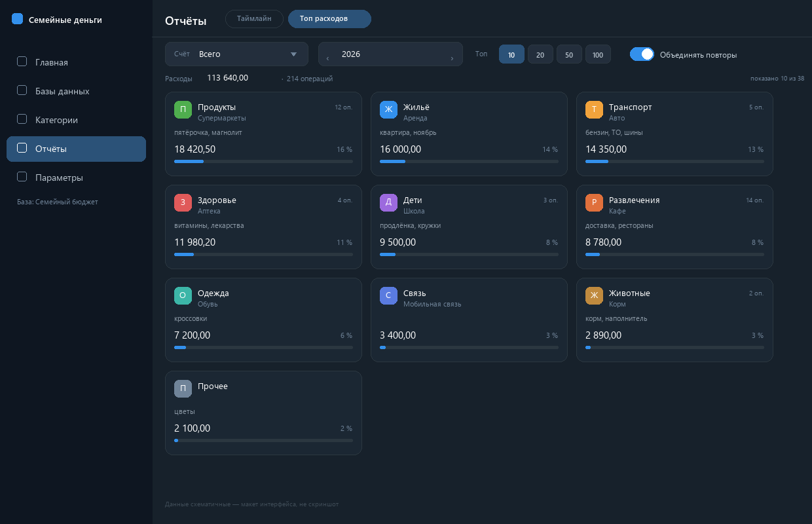

# Отчёт «Топ расходов»: анализ и план

Второй режим раздела «Отчёты»: самые крупные траты за период в виде карточек,
как сводка по категориям в мобильном приложении.



---

## 1. Задача

В разделе «Отчёты» рядом с «Таймлайном» появляется режим **«Топ расходов»**: карточки самых
больших трат за выбранный период с долей от общей суммы расходов.

Фильтры:

1. счёт (как в «Таймлайне»: «Всего» / группа / счёт), **свой у отчёта**;
2. период, **свой у отчёта**; по умолчанию — текущий год;
3. размер топа: 10 / 20 / 50 / 100;
4. объединение повторов по категории, подкатегории и комментарию (по умолчанию включено).

Фильтры отчёта не связаны ни с приложением, ни с «Таймлайном»: смена периода или счёта здесь
не меняет главный экран и соседний отчёт.

---

## 2. Что уже есть и переиспользуется

| Механизм | Где | Как используем |
|---|---|---|
| Раздел «Отчёты» | `ReportsViewModel`, `ReportsView.axaml` | добавляем второй режим рядом с «Таймлайном» |
| Выбор счёта | `TimelineScope`, `TimelineScopeCatalog`, `TimelineScopeResolver` | тот же список (иконки, группы, без скрытых) и то же правило суммирования |
| Период | `PeriodViewModel` (сейчас пишет в `MainState`) | нужен изолированный экземпляр: пресеты и диалог те же, но без записи в общее состояние |
| Карточка категории | `FamilyMoney.Navigation/Controls/TransactionsSummaryView.axaml` (`CategoryCard`) | визуальный образец: `IconBadge`, сумма, процент, полоса |
| Иконки категорий | `IconBadge` (картинка / material / буква / набор), `Category.Icon`, `IconColor` | берём как в мобильном |
| Данные | `IRepository.GetTransactions`, `GetCategories`, `GetSubCategories`, `TryGetImage` | загрузка операций и справочников |

Скрытые счета: в списке выбора их нет, но в суммы по «Всего» и группе они входят — как в «Таймлайне».

---

## 3. Экран

### 3.1 Шапка

- Заголовок «Отчёты» и два режима-пилюли: **Таймлайн** / **Топ расходов** (активный подсвечен).
- Строка фильтров (только для этого режима):
  - **Счёт** — тот же выпадающий список с иконками и группами, но своё выделение;
  - **Период** — та же пилюля с поповером, что на главном экране: `‹ 2026 ▾ ›`, в поповере
    вкладки «День / Месяц / Квартал / Год», сетка выбора и «Выбрать / Сегодня / Всё время».
    Период принадлежит отчёту, по умолчанию — текущий год;
  - **Топ** — сегменты `10 | 20 | 50 | 100`;
  - **Объединять повторы** — переключатель, включён по умолчанию;
  - **без комментариев** — доступен только при включённом объединении: группировка идёт
    только по категории и подкатегории.
- Строка сводки: `Расходы 113 640,00 · 214 операций · показано 10 из 38` слева.

Фильтры применяются сразу, без кнопки «Применить».

### 3.2 Карточки

Сетка с переносом: фиксированная ширина карточки (~300 px), количество в ряду подстраивается
под ширину окна (3–4 на десктопе, 1–2 в узком окне). Сортировка — по убыванию суммы.

Карточка:

```
┌──────────────────────────────────────────┐
│ (иконка) Продукты              12 оп.    │   категория (полужирный), подкатегория ниже
│          Супермаркеты                    │   счётчик операций (если объединено)
│ пятёрочка, магнолит                      │   комментарий (серая строка, обрезка)
│ 18 420,50                        16 %    │   сумма + доля
│ ▓▓▓▓▓▓░░░░░░░░░░░░░░░░░░░░░░░░░░░░░░░░░  │   шкала доли
└──────────────────────────────────────────┘
```

- **Категория** — имя + `IconBadge` (та же логика картинка/иконка/буква/набор, что в мобильном).
- **Подкатегория** — второй строкой, приглушённо; если её нет — строки нет.
- **Комментарий** — одна строка с обрезкой; пустой не заменяется заглушкой, строка остаётся пустой.
- **Сумма** — крупно, формат как в списках (`#,##0.00`).
- **Доля** — `P0` и полоса на всю ширину карточки.
- **Счётчик операций** — появляется только при объединении и только если операций больше одной.

Высота карточки фиксирована, чтобы ряды не «плясали».

### 3.3 Состояния

- Нет расходов за период: «За период нет расходов» + подсказка сменить период.
- Позиций меньше, чем размер топа: показываем все, сводка `показано 7 из 7`.
- Все операции идут одной группой: одна карточка со 100 % — это корректный ответ.
- Загрузка: как в «Таймлайне», без мигания (запросы синхронные, десятки миллисекунд).

---

## 4. Правила расчёта

### 4.1 Что считается расходом

Только операции типа «расход» (`CreditTransaction`). **Переводы не участвуют** — это перемещение
денег, а не трата, и они уже не входят в расходы на главном экране. Удалённые операции
исключаются. Отдельной настройки «учитывать переводы» не делаем.

### 4.2 Область счёта

Как в «Таймлайне»: «Всего» — все счета, включая скрытые; группа — все потомки на любую глубину
(скрытые тоже); отдельный счёт — только он. Скрытость влияет лишь на список выбора.

**Удалённые счета.** Удаление счёта в базе только помечает его (`DeletedAt`), операции остаются.
Для отчётов такие траты считаются: они входят в «Всего» и в суммы групп, к которым относился
счёт. Выбрать удалённый счёт отдельно нельзя — его нет в списке.

Следствие, которое надо держать в голове: если в базе есть операции удалённых счетов,
«Всего» в отчётах будет больше, чем «Всего» в левой панели главного экрана — там удалённые
счета не учитываются. Для отчётов это осознанное решение: «траты были — значит считаются».

### 4.3 Период

Период у отчёта свой: отдельный экземпляр `PeriodViewModel`, который не пишет в `MainState`
(см. §5.3). По умолчанию — **текущий год**. Пресеты и диалог произвольного интервала те же,
что на главном экране, но изменение периода здесь не затрагивает ни главный экран,
ни «Таймлайн».

«Всё время» ограничивается окном 1900–2100 при запросе к базе (как в «Таймлайне»).

### 4.4 Объединение повторов

Ключ группы: **категория + подкатегория + нормализованный комментарий**.

- комментарий нормализуется: `Trim`, схлопывание внутренних пробелов, сравнение без учёта регистра;
- пустой комментарий и `null` — одна и та же группа;
- в группе суммируются суммы, считается число операций;
- **топ-N применяется после объединения**: «10» — это 10 карточек, а не 10 операций.

Выключенное объединение — каждая операция отдельной карточкой (комментарий как есть).

#### Объединение без комментариев

Второй переключатель «без комментариев» доступен только при включённом объединении и убирает
комментарий из ключа: группа — **категория + подкатегория**.

- в карточке комментарий в этом режиме не показывается (его у позиции просто нет), в шапке
  панели — тоже;
- зато комментарий показывается в строках панели: это уже комментарий конкретной операции,
  и без него операции стали бы неразличимы;
- в обычном режиме строка панели комментарий не дублирует — он один на всю карточку и стоит
  в шапке.

### 4.5 Доля и итог

```
ВсегоРасходов = сумма всех расходных операций за период по выбранной области
Доля = СуммаПозиции / ВсегоРасходов
```

Знаменатель — **все** расходы за период, а не только попавшие в топ: иначе шкала показывала бы
долю внутри топа, что бессмысленно. Полоса рисуется по доле, подпись — `P0`.

### 4.6 Порядок

По убыванию суммы; при равных суммах — по числу операций, затем по названию категории,
подкатегории и комментарию (чтобы порядок был стабильным от запуска к запуску).

### 4.7 Имена и иконки

- Категория/подкатегория удалена, но на операции ссылается — показываем её имя (единичные
  запросы `GetCategory`/`GetSubCategory` для отсутствующих в справочнике id).
- Категория не указана — «Без категории», иконка-заглушка `TagOutline` (как в мобильном).
- Скрытые категории (`Category.IsHidden`) в отчёте показываем: траты были, скрывать их из
  аналитики неправильно.

---

## 5. Архитектура

### 5.1 Независимые фильтры

«Топ расходов» владеет своими фильтрами: своя коллекция счетов, своё выделение и свой период.
С «Таймлайном» и главным экраном они не связаны — смена счёта или периода здесь ничего
не меняет в других местах.

Общий остаётся только **справочник вариантов**:

- `TimelineScope` → `ReportAccount`, `TimelineScopeCatalog` → `ReportAccountCatalog`,
  `TimelineScopeResolver` → `ReportScopeResolver`;
- оба отчёта строят по нему свой плоский список, но выделение у каждого своё;
- переименование механическое, вместе с тестами.

**Изменение правила области:** `ReportScopeResolver` перестаёт отбрасывать счета
с `DeletedAt` — для отчётов это всё ещё счёт с операциями (§4.2). Список для выбора
по-прежнему строится только по живым счетам (`AccountsViewModel.Total`).

Чтобы резолвер видел удалённые счета, репозиторию нужен способ отдать их:
`IRepository.GetAccounts()` сейчас фильтрует `DeletedAt == null`. Добавляем
`IEnumerable<Account> GetAccounts(bool includeDeleted)` (или отдельный `GetAllAccounts()`)
и реализуем в `LiteDbRepository` и `DesignerRepository`.

`ReportsViewModel` держит `Timeline` и `TopExpenses` плюс текущий режим; `Enter`/`Reload`
вызывают оба отчёта.

### 5.2 Новые файлы

| Файл | Назначение |
|---|---|
| `src/FamilyMoney/Analytics/TopOperationsBuilder.cs` | чистая агрегация: фильтр по области и периоду, объединение, топ-N, итог |
| `src/FamilyMoney/Analytics/TopOperationGroup.cs` | `record(Guid? CategoryId, Guid? SubCategoryId, string? Comment, decimal Sum, int Count)` |
| `src/FamilyMoney/Analytics/TopOperationsResult.cs` | `record(IReadOnlyList<TopOperationGroup> Items, decimal Total, int Transactions, int Positions)` |
| `src/FamilyMoney/ViewModels/TopOperationsViewModel.cs` | свои фильтры, пересчёт, карточки, сводка |
| `src/FamilyMoney/ViewModels/TopOperationCardViewModel.cs` | данные карточки: имя, иконка, сумма, доля, число операций |
| `src/FamilyMoney.Desktop/Views/TopOperationsView.axaml` | сетка карточек и пустые состояния |
| `src/FamilyMoney.Desktop/Views/TimelineReportView.axaml` | текущее содержимое «Таймлайна», вынесенное из `ReportsView` |
| `src/FamilyMoney.Desktop/Views/PeriodPickerView.axaml` | период отчёта: пилюля с поповером `PeriodPicker`, без хоткеев |
| `tests/FamilyMoney.Tests/TopOperationsBuilderTests.cs` | тесты агрегации |

`TopOperationsBuilder` не знает про UI: на вход операции, набор счетов, границы периода,
размер топа и флаг объединения; на выход — группы с суммами. Имена и иконки подставляет VM.

### 5.3 Изменения в существующем

| Файл | Изменение |
|---|---|
| `ReportsView.axaml` | заголовок с двумя режимами, переключение панелей, вынос «Таймлайна» в отдельный view |
| `ReportsViewModel.cs` | режимы (`Timeline` / `TopExpenses`), `Enter`/`Reload` для обоих |
| `PeriodViewModel.cs` | второй конструктор с `updateMainState: false` — пресеты и диалог те же, но без записи в `MainState` |
| `TimelineViewModel.cs` | использует переименованные `ReportAccount*`; поведение не меняется |
| `IRepository`, `LiteDbRepository`, `DesignerRepository` | метод, отдающий счета вместе с удалёнными (для области отчётов) |
| `TimelineScope*.cs` → `ReportAccount*.cs` | переименование и общий справочник |
| `AppInit.cs` | `+ TopOperationsViewModel`; `PeriodViewModel` остаётся transient (главному экрану — свой, отчёту — свой) |
| `README.md` | раздел про отчёты |

Изолированный период создаётся как `new PeriodViewModel(stateManager, updateMainState: false)`
и сразу переводится на текущий год (`SetYear(DateTime.Today.Year)`). Запись в `MainState`
отключается флагом в `Update()` — иначе смена периода в отчёте меняла бы главный экран.

### 5.4 Поток данных

```
Фильтр (счёт, период, топ, объединять)
        │  изменение
        ▼
TopOperationsViewModel.Refresh()
        │  GetTransactions(period) → фильтр по счетам области
        ▼
TopOperationsBuilder.Build(...)  →  группы (id категории/подкатегории, комментарий, сумма, N)
        │  справочники: GetCategories/GetSubCategories/GetCategory/TryGetImage
        ▼
ObservableCollection<TopOperationCardViewModel>  →  WrapPanel карточек
```

Пересчёт — на каждое изменение фильтра и на `TransactionChangedMessage`
(добавили/удалили операцию — отчёт обновился).

---

## 6. Производительность

- Один проход по операциям периода: O(n), память — словарь групп.
- Для «Всё время» на 50 тыс. операций — десятки миллисекунд, как у «Таймлайна»; запросы
  синхронные по той же причине (LiteDB держит файл эксклюзивно).
- Картинки категорий читаются один раз на уникальную категорию (кэш в пределах пересчёта).
- Отрисовка: до 100 карточек — обычный `WrapPanel`, виртуализация не нужна.

---

## 7. Этапы

| № | Этап | Результат | Оценка |
|---|---|---|---|
| 1 | Переключатель режимов | две пилюли, разделение `ReportsView` на «Таймлайн» и «Топ расходов», `ReportAccount*`, счета с `DeletedAt` в области | 0,75 д |
| 2 | Свой период | `PeriodViewModel` с отключённой записью в `MainState`, `PeriodPickerView`, старт на текущем году | 0,5 д |
| 3 | Агрегация + тесты | `TopOperationsBuilder`, объединение, топ-N, доля, тесты | 1 д |
| 4 | Карточки | `TopOperationsView`, шаблон карточки, `IconBadge`, обрезка текста, полоса | 1 д |
| 5 | Фильтры и состояния | свой счёт, топ 10/20/50/100, переключатель, сводка, пустые состояния | 0,5 д |
| 6 | Полировка | проверка на демо-базе, README, прогон чек-листа | 0,5 д |

Итого ≈ 4 рабочих дня.

---

## 8. Тесты

`TopOperationsBuilderTests` (чистая логика, без UI):

1. Только расходы: доходы и переводы не попадают в топ.
2. Область: «Всего» включает скрытые счета; отдельный счёт — только его.
3. Удалённый счёт: его операции входят в «Всего» и в свою группу, но самого счёта нет в списке.
4. Период: границы включительно, «Всё время» подрезается к данным.
5. Объединение: одинаковые категория+подкатегория+комментарий → одна группа, суммы и счётчик
   складываются.
6. Нормализация комментария: регистр и лишние пробелы.
7. Пустой комментарий: `null` и `""` — одна группа.
8. Топ-N после объединения (10 групп, а не 10 операций).
9. Доля считается от всех расходов, а не от суммы топа.
10. Порядок при равных суммах стабилен.
11. Пустой результат: нет расходов.

Ручной чек-лист: смена счёта/периода/топа/объединения, 100 карточек и прокрутка, узкое окно
(перенос карточек), тёмная и светлая темы, пустой период.

---

## 9. Риски

| Риск | Смягчение |
|---|---|
| Пользователь ждёт, что счёт из «Таймлайна» перенесётся | фильтры независимы осознанно; при входе в отчёт — «Всего» и текущий год |
| Смена периода в отчёте меняет главный экран | период изолирован: `Update()` не пишет в `MainState` |
| Доля считается от топа и шкалы «врут» | знаменатель — все расходы периода, это зафиксировано тестом |
| Тяжёлый пересчёт на «Всё время» | один проход, кэш иконок, синхронно (как в таймлайне) |
| Длинные комментарии ломают сетку | фиксированная высота карточки + обрезка |
| Два периода и два списка счетов в коде | общий только справочник `ReportAccount*`, состояние у каждого отчёта своё |
| «Всего» в отчётах не совпадает с левой панелью из-за операций удалённых счетов | осознанно: в отчётах траты удалённых счетов считаются; в интерфейсе счёт удалить нельзя, так что случай редкий |

---

## 10. Решения и что осталось

Зафиксировано:

1. **Переводы** — не считаем тратами.
2. **Период и счёт** — свои у отчёта, не связаны с приложением и другими отчётами.
3. **Период по умолчанию** — текущий год.
4. **Объединение комментариев** — без учёта регистра и лишних пробелов.
5. **Пустой комментарий** — пустая строка, без заглушки.
6. **Скрытые категории** — показываем (это реальные траты).
7. **Скрытые и удалённые счета** — их траты входят в «Всего» и в группу, отдельно выбрать нельзя.
8. **Доля** — от всех расходов периода, не от топа.
9. **Топ-N** — после объединения.
10. **Ширина карточки** — 300 px (одна константа на весь отчёт).
11. **Сохранение фильтров** между запусками — не делаем.
12. **Клик по карточке** — переход на главный экран откатили; вместо него сделана панель
    операций карточки справа, см. [top-expenses-details.md](top-expenses-details.md).

Осталось только то, что решается по месту: конкретные отступы и размер иконки в карточке,
показ счётчика операций при выключенном объединении (там всегда 1 — не показываем).

---

## 11. Вне рамок

- Сравнение с предыдущим периодом и динамика.
- Группировка карточек по категориям (сейчас плоский список).
- Экспорт топа в CSV/картинку.
- Мобильная версия отчёта (карточки там уже есть, но нужен свой экран).

---

## 12. Статус реализации

Готово целиком; на том же коде сделан «Топ доходов» — см. [reports-top-incomes.md](reports-top-incomes.md).

Новые файлы:

- `Analytics/TopOperationsBuilder.cs`, `TopOperationGroup.cs`, `TopOperationsResult.cs` — агрегация;
- `Analytics/TopOperations.cs` — операции карточки и группировка по дням;
- `ViewModels/TopOperationsViewModel.cs`, `TopOperationCardViewModel.cs` — фильтры и карточки;
  наследники `TopExpensesViewModel` и `TopIncomesViewModel` задают вид операций;
- `Desktop/Views/TopOperationsView.axaml`, `TimelineReportView.axaml`, `PeriodPickerView.axaml`;
- `tests/FamilyMoney.Tests/TopOperationsBuilderTests.cs`, `TopOperationsTests.cs`.

Изменения по дороге:

- `TimelineScope` → `ReportAccount`, `TimelineScopeCatalog` → `ReportAccountCatalog`,
  `TimelineScopeResolver` → `ReportScopeResolver` — справочник общий для двух отчётов,
  фильтры у каждого свои.
- `ReportScopeResolver` больше не отбрасывает счета с `DeletedAt`: их операции входят в «Всего»
  и в группу. Появился `IRepository.GetAccounts(bool includeDeleted)`.
- `PeriodViewModel.UpdatesMainState` — изолированный период отчёта: пресеты и диалог те же,
  но `MainState` не трогается (проверено: смена года в отчёте не меняет главный экран).
- `ReportsView` разделён на переключатель режимов и независимые view.
- `MoneyFormat.CompactAxis` — попутное исправление «Таймлайна»: при узком диапазоне на большом
  остатке все деления подписывались одинаково («1,11 млн»), теперь «1,105 млн», «1,110 млн».
- `TopExpenses*` → `TopOperations*`: расчёт общий для расходов и доходов, вид задаётся
  `TopOperationKind`.

Проверено вживую: смена счёта, периода (2025/2026), размера топа (10/20), объединения повторов,
изоляция периода от главного экрана, иконки категорий, доли и полосы, перенос карточек по ширине.
Тестов — 258, сборка без предупреждений.

### Клик по карточке

Первая версия (переход на главный экран с фильтром) проверена и **откачена** — в древовидном
списке группировка уже есть, пользы не добавило. Вместо неё сделана панель операций выбранной
карточки справа: см. [top-expenses-details.md](top-expenses-details.md).

Из той работы остались: `CommentNormalizer` (общая нормализация комментария) и защита от гонки
в `TransactionsViewModel.RefreshTransactions` — параллельные пересборки дерева применялись
в произвольном порядке, и более ранняя могла перетереть свежую.
