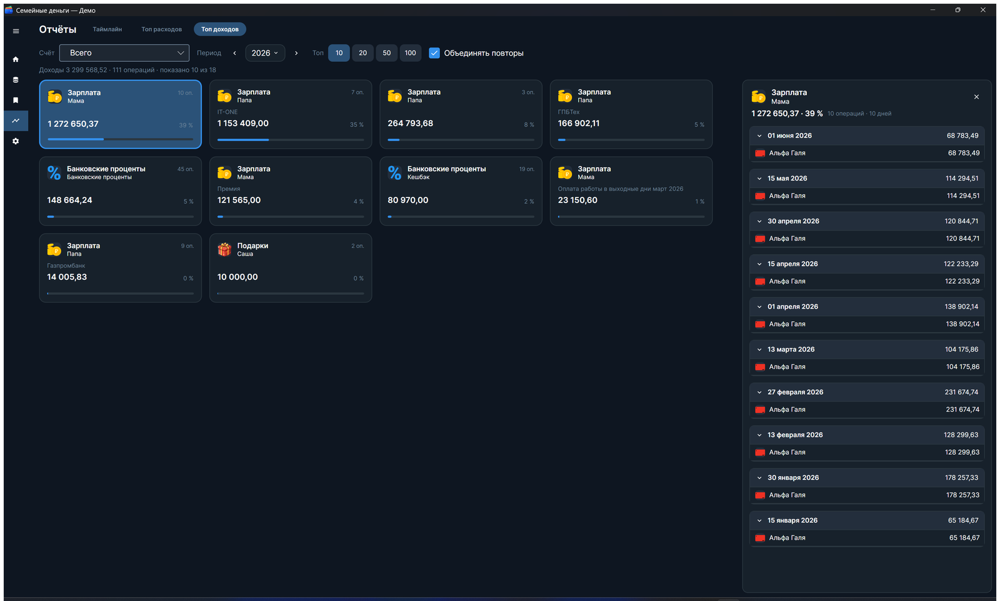

# Топ доходов

Зеркальный отчёт к «Топу расходов»: те же карточки, фильтры и панель операций, но считаются
поступления, а доля берётся от всех доходов периода.

## Чем отличается от «Топа расходов»

| | Топ расходов | Топ доходов |
|---|---|---|
| Операции | `CreditTransaction` | `DebetTransaction` |
| Сумма в сводке | «Расходы …» | «Доходы …» |
| Доля | от всех расходов периода | от всех доходов периода |
| Пустое состояние | «За период нет расходов» | «За период нет доходов» |

Всё остальное совпадает: фильтры (счёт, период, размер топа, объединение повторов),
карточки (категория, подкатегория, комментарий, сумма, доля, число операций), панель
операций по дням, правила объединения по категории + подкатегории + нормализованному
комментарию, сортировка по убыванию суммы.

## Устройство общего кода

Чтобы не держать две копии, логика вынесена в нейтральные по смыслу классы:

- `Analytics/TopOperationsBuilder.cs` — агрегация; вид операций задаётся
  `TopOperationKind` (`Expense` / `Income`);
- `Analytics/TopOperations.cs` — выбор операций карточки и группировка по дням,
  вид передаётся тем же `TopOperationKind`;
- `ViewModels/TopOperationsViewModel.cs` — фильтры, карточки, панель, выделение;
  наследники только задают вид:
  - `TopExpensesViewModel : TopOperationsViewModel` (`Expense`),
  - `TopIncomesViewModel : TopOperationsViewModel` (`Income`);
- `ViewModels/TopOperationCardViewModel.cs`, `OperationDayGroupViewModel.cs`,
  `OperationRowViewModel.cs` — карточки и строки панели, общие для двух отчётов;
- `Desktop/Views/TopOperationsView.axaml` — один вид на оба отчёта.

`ReportsViewModel` держит оба отчёта (`TopExpenses`, `TopIncomes`) и режим `ReportMode`
(`Timeline` / `TopExpenses` / `TopIncomes`). У каждого отчёта свои фильтры и свой период:
смена периода в одном не трогает другой и главный экран.

## Проверки

- Тесты: `TopOperationsBuilderTests` (расходы и доходы, объединение, доли, порядок),
  `TopOperationsTests` (выбор операций карточки по виду, нормализация комментария,
  группировка по дням). Всего в проекте 258 тестов.
- Вживую: переключение режимов, карточки доходов с долями, панель операций по дням,
  смена периода и счёта в отчёте доходов не влияет на отчёт расходов.
