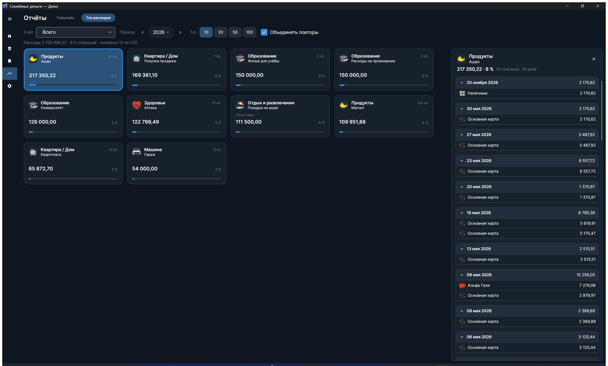

# Топ расходов: панель операций карточки

Развитие отчёта «Топ расходов»: клик по карточке выбирает её и открывает справа панель
с операциями этой позиции, разбитыми по дням — в том же виде, что обычный дневной список.



---

## 1. Что меняем

1. **Откатываем переход на главный экран** (клик по карточке → главный экран с фильтром):
   функция не прижилась. Удалены `OpenExpenseInTransactionsMessage`, обработчик в
   `MainViewModel`, `ApplyExpenseFilterAsync` и поля фильтра в `TransactionsViewModel`,
   `PeriodViewModel.SetRange`, блок «Из отчёта…» в флайауте фильтра.
2. **Оставляем клик по карточке**, но он делает другое: помечает карточку выбранной и
   открывает панель операций справа.

Из отката сохранено то, что полезно само по себе:

- `CommentNormalizer` — общая нормализация комментария (её использует и группировка отчёта,
  и будущая выборка операций карточки);
- защита от гонки в `TransactionsViewModel.RefreshTransactions` (применяется только
  результат последней пересборки) — независимое исправление реального дефекта;
- `CategoryId`/`SubCategoryId` в карточке — нужны, чтобы найти её операции.

---

## 2. Экран

### 2.1 Выбор карточки

- Клик по карточке — она становится выбранной: акцентная рамка и чуть более светлый фон.
- Одновременно открывается панель справа; карточки перестраиваются по ширине (на широком
  окне было 5 в ряд, с панелью — 3–4).
- Повторный клик по выбранной карточке закрывает панель (как переключатель).
- Клик по другой карточке переключает панель на неё.
- Закрыть панель: повторный клик по выбранной карточке или крестик в её шапке.
  `Esc` не используем: обработчик не срабатывал без клавиатурного фокуса в окне и только
  вводил в заблуждение.

### 2.2 Панель

Ширина ~460 px (перетаскивается сплиттером, минимум 320), высота — вся область отчёта,
скруглённые углы (радиус 10, чуть меньше, чем у карточек), внутри прокрутка. Содержимое:

```
┌──────────────────────────────────────────────┐
│ (иконка) Продукты                        ✕   │
│          Ашан                                │
│  «пятёрочка, магнит» — полностью, с переносом│
│ 217 350,22 · 8 % · 55 операций · 29 дней     │
├──────────────────────────────────────────────┤
│ ⌄ 20 ноября 2026                    2 170,62 │
│    Наличные                         2 170,62 │
├──────────────────────────────────────────────┤
│ ⌄ 27 мая 2026                       5 658,54 │
│    Основная карта  [пятёрочка]      3 487,92 │
│    Наличные        [магнит]         2 170,62 │
└──────────────────────────────────────────────┘
```

- **Шапка панели**: иконка категории, категория и подкатегория отдельными строками,
  комментарий позиции с переносом строк (читается целиком), сумма, доля от всех расходов,
  число операций и дней, крестик.
- **День** — как в дневном списке: заголовок с датой и суммой за день, сворачивается кликом
  по заголовку (эффект нажатия — расходящиеся волны), по умолчанию дни развёрнуты.
- **Строка операции**: иконка и название счёта, теги чипами (справа, рядом с суммой), сумма.
  Комментарий в строках не повторяем — он один на всю карточку и показан в шапке.
- **Подкатегория** в шапке и в карточках — цветом основной текст, как категория, только
  мельче: иначе она не отличалась от серого комментария.
- Суммы положительные и нейтрального цвета — как в отчёте. В дневном списке расход показан
  отрицательным и красным, но здесь это разбивка одной и той же суммы, и знак «минус»
  у каждой строки только запутал бы.

### 2.3 Порядок

Дни — по убыванию даты, внутри дня операции — по убыванию суммы (крупные сверху).

---

## 3. Данные

Источник — те же операции, что уже прочитаны для отчёта: `TopExpensesViewModel` при пересчёте
держит список операций в памяти (на демо-базе 812 штук за год), поэтому открытие панели
не ходит в базу.

Отбор операции в карточку повторяет группировку отчёта ровно:

```
type == CreditTransaction
&& DeletedAt == null
&& AccountId в области отчёта
&& дата в периоде отчёта
&& CategoryId == карточка.CategoryId
&& SubCategoryId == карточка.SubCategoryId
&& CommentNormalizer.Normalize(Comment) == нормализованный комментарий карточки
```

Именно поэтому нормализация вынесена в общий `CommentNormalizer`: иначе панель могла бы
показать не то, что посчитала карточка.

Группировка по `Transaction.Date.Date` (в базе у операции только дата, без времени),
сумма дня — сумма операций дня.

---

## 4. Архитектура

### 4.1 Модель представления

`TopExpensesViewModel` получает:

```csharp
[ObservableProperty] TopExpenseCardViewModel? SelectedCard;
[ObservableProperty] bool IsDetailsOpen;
ObservableCollection<ExpenseDayGroupViewModel> Details;   // дни и строки
string DetailsTitle;        // «Продукты / Ашан»
string? DetailsComment;     // комментарий позиции, если есть
string DetailsTotalText;    // «217 350,22 · 8 %»
string DetailsMetaText;     // «55 операций · 29 дней»

void SelectCard(TopExpenseCardViewModel card);  // повторный клик закрывает
void CloseDetails();
```

`ExpenseDayGroupViewModel`: `DateText` («20 ноября 2026»), `Sum`, `Items`, `IsExpanded`,
`ToggleCommand`.

`ExpenseRowViewModel`: `AccountName`, `ShowAccount` (только для «Всего»), `Tags`, `HasTags`,
`Sum`.

Открытие панели — построение `Details` из кэша операций; закрытие — очистка и снятие выделения.

### 4.2 Вид

`TopExpensesView` превращается в `Grid` из двух колонок: карточки (`*`) и панель
(фиксированная ширина, `IsVisible="{Binding IsDetailsOpen}"`). Внутри панели — `ScrollViewer`
со списком дней.

Стили дня (`DayCard`, заголовок, строка, чипы тегов) берём те же, что в
`TransactionsByDatesView`, и переносим в общие ресурсы темы или в ресурсы `TopExpensesView`,
чтобы вид совпадал. Готовый `TransactionsByDatesView` целиком переиспользовать не получится:
он привязан к `TransactionsViewModel` и тянет команды копирования/удаления, выбор и проценты.

### 4.3 Изменения в существующем

| Файл | Что |
|---|---|
| `TopExpensesViewModel.cs` | кэш операций, выбор карточки, панель |
| `TopExpensesView.axaml` | две колонки, шаблон панели, стили дня |
| `TopExpensesView.axaml.cs` | обработчик клика по карточке (выбор) |
| `TopExpenseCardViewModel.cs` | без изменений: id категории уже есть |
| `TransactionsViewModel.cs` | только защита от гонки (из отката) |

---

## 5. Крайние случаи

- **Одна операция** в карточке: панель показывает один день и одну строку.
- **Большая карточка** (в демо-базе есть 349 операций): панель скроллится; при необходимости
  ограничим число строк на день, но на 350 строк текста виртуализация не нужна.
- **«Без категории» / без подкатегории / пустой комментарий**: ключ карточки из `null`,
  панель ищет операции с пустыми значениями; в шапке — «Без категории».
- **Удалённая категория**: имя уже разрешено для карточки, панель использует его же.
- **Смена фильтров при открытой панели**: отчёт пересобирается; если выбранной карточки
  больше нет (сменили счёт, период, топ или выключили объединение) — панель закрывается.
  Если карточка осталась — панель обновляет данные.
- **Смена базы данных**: отчёт перезагружается, панель закрывается.
- **Переключение на «Таймлайн»** и обратно: панель закрыта (состояние отчёта сбрасывается
  вместе с пересборкой при входе в раздел).

---

## 6. Этапы

| № | Этап | Результат | Оценка |
|---|---|---|---|
| 1 | Выбор карточки | `SelectedCard`, стиль выбранной карточки, клик/повторный клик | 0,5 д |
| 2 | Данные панели | кэш операций, отбор по ключу, группировка по дням, модель и тесты | 1 д |
| 3 | Панель | шапка, дни, строки, стили как в дневном списке, прокрутка | 1 д |
| 4 | Связка и состояние | пересборка при смене фильтров, закрытие, ширина и перенос карточек | 0,5 д |
| 5 | Полировка | проверка на демо-базе, README, обновление плана | 0,5 д |

Итого ≈ 3,5 рабочих дня.

---

## 7. Тесты

Чистая логика (без UI):

1. Отбор операций по ключу карточки: категория, подкатегория, нормализованный комментарий.
2. Пустые значения как условие: «без категории», «без подкатегории», «без комментария».
3. Группировка по дням: сумма дня, число строк, порядок дней по убыванию.
4. Только расходы: доходы и переводы не попадают.
5. Удалённые операции не попадают.
6. Границы периода включительно.
7. Карточка из одной операции.
8. Пустой результат (например, данные изменились) — панель закрывается.

Ручной чек-лист: выбор карточки, повторный клик, переключение карточек, крестик,
смена счёта/периода/топа/объединения при открытой панели, большая карточка (прокрутка),
«Без категории», светлая и тёмная темы, узкое окно (панель и карточки не наезжают).

---

## 8. Решения

1. **Ширина** — стартовая 460, изменяется `GridSplitter` (минимум 320).
2. **Комментарий** — только в шапке панели, с переносом строк: в строках он один и тот же
   у всей карточки. (Сначала дублировали в строках — отказались.)
3. **Копирование/удаление** — не делаем, панель только для просмотра.
4. **Дни** — развёрнуты по умолчанию, сворачиваются кликом по заголовку.
5. **Анимация** — плавное раскрытие ширины, 220 мс, cubic ease-out (как у `CollapsiblePanel`).
6. **Запоминать выбранную карточку** — нет.
7. **`Esc`** — не используем: не закрывал панель и вводил в заблуждение, убрали.
8. **Углы панели** — скруглённые, радиус 10 (чуть меньше, чем 12 у карточек).
9. **Шапка** — категория и подкатегория отдельными строками, комментарий целиком.
10. **Строка операции** — иконка и название счёта, теги, сумма. Иконка счёта информативнее
    иконки категории: категория и так одна на всю панель.

---

## 9. Реализовано

- `Analytics/TopExpenseTransactions.cs` — `Select` (отбор по ключу карточки) и `GroupByDay`
  (дни по убыванию, внутри дня по убыванию суммы).
- `ViewModels/ExpenseDayGroupViewModel.cs`, `ExpenseRowViewModel.cs` — модель дней и строк.
- `TopExpensesViewModel`: кэш операций последнего пересчёта и оформления счетов,
  `SelectedCard`, `Details`, `SelectCard`/`CloseDetails`, восстановление выделения после
  пересчёта (если позиция осталась в топе — панель обновляется, если исчезла — закрывается).
- `TopExpensesView`: две колонки (карточки и панель), `GridSplitter`, скруглённая панель,
  шапка с категорией/подкатегорией и комментарием, дни как в дневном списке
  (включая эффект нажатия «волны»), строки с иконкой счёта.
- Ширина панели анимируется в code-behind: содержимое фиксируется в целевой ширине,
  чтобы текст не переверстывался на каждом кадре, а анимация стартует после первого
  прохода раскладки — иначе она целиком уходит в блокирующий layout большого списка.

Проверено: выбор карточки, повторный клик, крестик, перенос карточек при открытой панели,
иконки и названия счетов в строках, промежуточный кадр анимации. 255 тестов, сборка без
предупреждений.

Попутные правки по ходу:

- сводка над карточками — одна строка слева: «Расходы … · 812 операций · показано 10 из 235»
  (раньше «показано …» уезжало вправо и терялось при открытой панели);
- комментарий в карточке — одна строка с многоточием (`CommentSingleLine` + `MaxLines=1`):
  многострочный комментарий ломал карточку фиксированной высоты и наезжал на сумму;
  в шапке панели он по-прежнему переносится и читается целиком.

